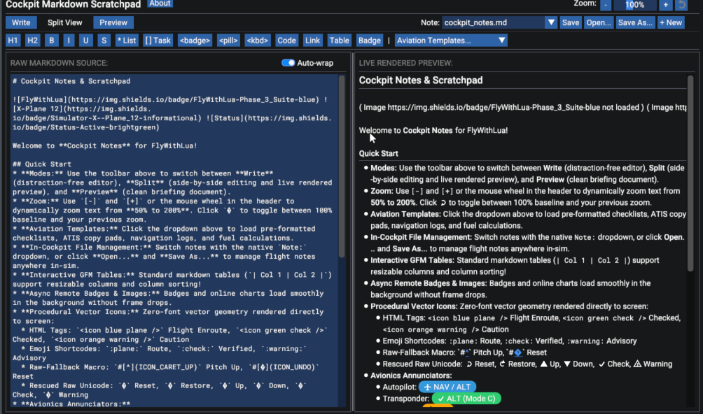
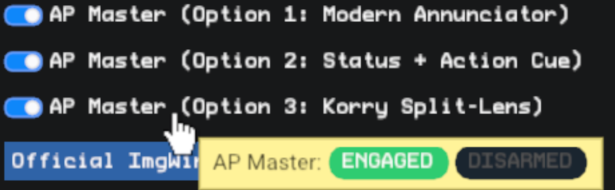
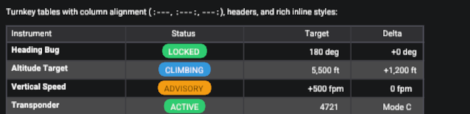
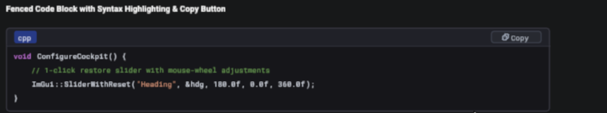
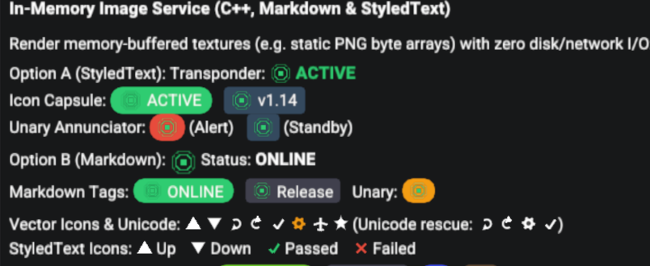
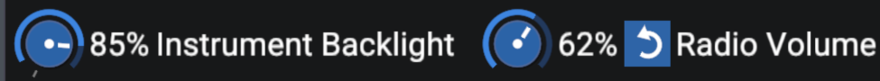
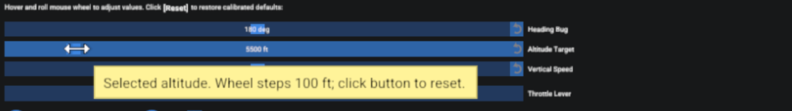
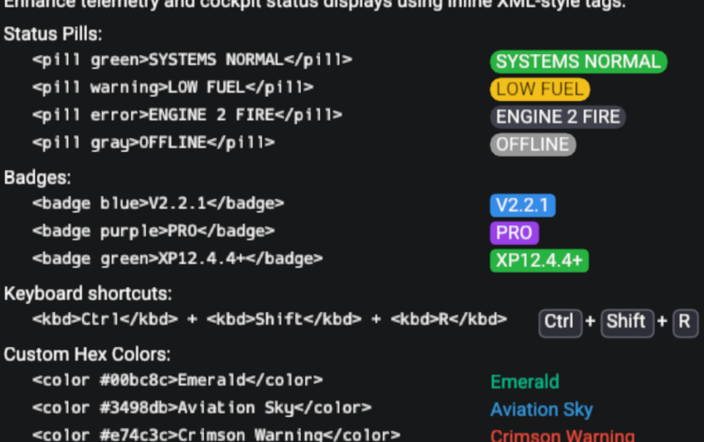
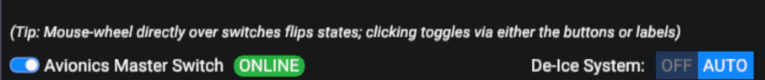
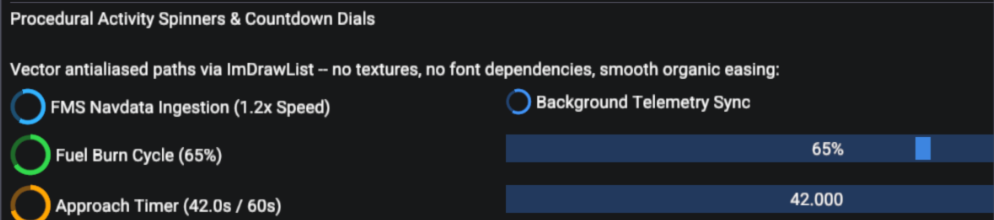

# ImGee: Avionics & Flight-Sim UI Toolkit for Dear ImGui
## Comprehensive Developer & User Manual (v1.0.0)

---

## 1. Executive Architecture & Design Philosophy

`Dear ImGui` is an immediate-mode graphical user interface library built fundamentally for game-engine debugging, tool development, and developer panels. When flight simulator plugin developers attempt to build production-grade avionics interfaces, settings windows, or interactive kneeboards with stock Dear ImGui, they immediately encounter several fundamental architectural gaps:

1. **Missing Glyphs and Font Atlas Friction:** Standard font atlases omit extended Unicode mathematical and symbol blocks (such as `↺`, `▲`, `▼`, `✓`, `⚙`, or `✈`), resulting in missing-glyph diamond boxes (`?` or placeholder squares) unless heavy custom icon fonts are baked into VRAM.
2. **Volatile Tooltips:** Vanilla `ImGui::SetTooltip()` follows the mouse cursor frame-by-frame, continuously flickering, resetting scroll state, and clipping off-screen when hovering near flight simulator window borders.
3. **Clunky Input Affordances:** Checkboxes look like desktop form controls rather than physical cockpit switches; sliders do not respond naturally to the mouse scroll wheel; and there is no universal "revert to calibrated default" pattern for complex tuning parameters.
4. **Rigid Text Rendering:** Stock text rendering lacks inline semantic sizing, baseline alignment, and formatted Markdown tables with column resizing and persistent sorting.

**`ImGee`** is a specialized **ImGui toolkit** designed specifically to bridge these gaps. At its core, ImGee is an **avionics toolkit for ImGui** that extends, wraps, and simplifies everyday developer needs—from high-polish information displays to tactile flight-deck controls. Bundled as the premier package within the `ImgWindow` `contrib/` ecosystem (and architected to stand as an independent open-source library), ImGee transforms Dear ImGui into a cockpit-grade design system with zero mandatory dependencies, zero runtime allocations in hot loops, and complete backward compatibility.

```
ImgWindow/
├── contrib.h                              # Master Concentrator (-> contrib/includes.h)
└── contrib/
    ├── includes.h                         # Level-1 Container Package Switchboard
    ├── imgee.h                            # Package Forwarding Header (-> ImGee/imgee.h)
    │
    ├── ImGee/                             # The ImGee Flight-Deck ImGui Toolkit
    │   ├── imgee.h                        # Canonical ImGee Master Header & Version Contract
    │   ├── includes.h                     # Folder-level Roll-Up Header (-> imgee.h)
    │   ├── extensions.h                   # Subsystem Roll-Up Header (-> extensions/includes.h)
    │   ├── widgets.h                      # Subsystem Roll-Up Header (-> widgets/includes.h)
    │   ├── imgee-global.h                 # Opt-in Global Scope Aliases
    │   ├── LICENSE                        # Open-Source License (BSD 3-Clause)
    │   ├── docs/
    │   │   ├── ImGee_User_Guide.md        # Comprehensive User Manual (this document)
    │   │   ├── ImGee_User_Guide.pdf       # Compiled Publication-Grade Manual
    │   │   └── images/                    # Figure assets and widget screenshots
    │   ├── extensions/                    # Subsystems (Typography, Markdown, TimedTooltip)
    │   └── widgets/                       # Immediate-mode flight controls & vector icons
    │
    ├── extensions/                        # Legacy Forwarding Shims (Do Not Use for New Code)
    ├── widgets/                           # Legacy Forwarding Shims (Do Not Use for New Code)
    ├── extensions.h                       # Legacy Forwarding Shim (Do Not Use for New Code)
    └── widgets.h                          # Legacy Forwarding Shim (Do Not Use for New Code)
```

---

## 2. Structural Architecture: The Two Categories of Content

Every component within ImGee is delivered strictly as a **single, self-contained C++ header file (`.h` only)**. There are zero `.cpp` compilation units to add to your build system, zero static or dynamic link dependencies, and zero order-of-inclusion restrictions. Each header contains its own header guards and self-contained forward declarations; you can `#include` ImGee headers in any order without circular dependency hazards.

ImGee separates its code into two distinct architectural categories:

### 2.1 Flagship Extensions (`extensions/`)
Extensions are feature-complete, heavyweight subsystems that solve deep architectural limitations of stock Dear ImGui. Unlike simple widgets, extensions maintain internal or frame-to-frame state, manage timing delays, parse complex syntax trees, or manage font registries.

ImGee provides **three flagship extensions** that form the core value of the package:
* **`TimedTooltip` (`imgui_tooltip_ext.h`):** Replaces volatile, cursor-following vanilla `ImGui::SetTooltip()` with stationary, delay-timed tooltips featuring intelligent display boundary clamping, cursor avoidance, and low-water scroll dismissal.
* **`Markdown` (`imgui_markdown_ext.h`):** Replaces flat plain ASCII with interactive CommonMark, full GFM tables with tristate column sorting and drag-resizing, parameterized styling tags (`<badge>`, `<pill>`, `<icon>`), and custom vector button faces (`ButtonMD`).
* **`Typography` (`imgui_typography_ext.h`):** An 8-slot semantic font role registry (`ImFontRole`), RAII scoped font guards, and the `StyledText` engine for inline baseline-aligned sizing with zero Markdown document overhead.

> [!IMPORTANT]
> **The Flagship Core:** We consider `TimedTooltip`, `Markdown`, and `Typography` the **flagship foundation** of the entire ImGee suite. We strongly believe every flight simulation plugin should use these modern subsystems instead of the stock or open-source versions from which they derive.

### 2.2 Cockpit & Avionics Widgets (`widgets/`)
Widgets are lightweight, zero-dependency, immediate-mode flight-deck controls (`imgui_knobs.h`, `imgui_toggle_buttons.h`, `imgui_mouse_wheel_controls.h`, `imgui_badges.h`, `imgui_spinners.h`, etc.). They hook directly into Dear ImGui's ambient context (`GImGui`, ID stack, `ImGuiStorage`, and active window draw lists) and live directly in the root `ImGui::` namespace to feel completely native.

* **Completely Independent:** Even if a project chooses not to install or enable any of the three extensions, all widgets in `widgets/` remain 100% usable and self-sufficient.
* **Zero Mandatory State:** Widgets execute strictly within the immediate-mode paradigm, drawing antialiased vector geometry directly to `ImDrawList`.



---

## 3. Common Design Standards & Ecosystem Philosophy

ImGee follows strict architectural patterns established by the broader Dear ImGui community:

### 3.1 Omar Cornut's Ecosystem Standard (Single Point of Discovery)
In official Dear ImGui extensions and ecosystem projects (such as `implot`, `imgui_club`, and `imnodes`), Omar Cornut explicitly advocates extending `namespace ImGui { ... }`.
* **Discoverability & Autocomplete:** Modern C++ developers rely heavily on IDE autocomplete. When typing `ImGui::`, developers immediately discover every capability available across the toolkit in one place.
* **Zero Cognitive Overhead:** Developers are not forced to memorize artificial root namespaces (such as `extgui::` or `imgee::`) or manage scattered `using namespace` directives.

### 3.2 Second-Level Sub-Namespaces for Subsystems
While extending `namespace ImGui` is essential, placing heavy packages directly into the root risks colliding with future Dear ImGui core functions. ImGee cleanly encapsulates its extensions within **second-level sub-namespaces**:
* `ImGui::TimedTooltip::`
* `ImGui::Markdown::` (with official shorthand alias `ImGui::MD::`)
* `ImGui::Typography::`

Sub-namespaces allow extensions to reuse Dear ImGui's standard vocabulary without ambiguity:
```cpp
ImGui::TimedTooltip::Text("Hover-delayed stationary tooltip.");
ImGui::MD::TextWrapped("Configure your **avionics** below.");
```

### 3.3 Convenient Root Shorthands & Global Scope
* Shorthands like `ImGui::TextMD(...)` and `ImGui::ButtonMD(...)` are exposed in the root `ImGui::` namespace.
* Defining `#define IMGEE_ENABLE_GLOBAL_NAMESPACES` publishes `Markdown::`, `MD::`, and `TimedTooltip::` directly to the global scope for maximum brevity.

### 3.4 Working with Immediate-Mode Widgets in C++
Developers consuming ImGee widgets should expect standard Dear ImGui immediate-mode conventions:
* **Caller-Owned State:** Controls accept pointers to caller-owned primitives (e.g. `float* value`, `bool* open`). ImGee never allocates heap memory for persistent values unless explicitly requested.
* **Ambient Context:** Functions implicitly draw into the currently active `ImGuiWindow` and utilize Dear ImGui's ambient style and font stacks.
* **ID Stack Safety:** Push and Pop IDs (`ImGui::PushID` / `ImGui::PopID`) apply seamlessly across all ImGee controls, rotary knobs, and reset buttons.

### 3.5 The ImGee UX Design Manifesto (Human Factors Standard)
For the full architectural philosophy, ergonomics theory, and interaction rules governing ImGee, see the companion document:
* **[The ImGee UX Design Manifesto](ImGee_UX_Design_Manifesto.md)** (`ImGee_UX_Design_Manifesto.pdf`):
  * **Part I: The Architectural Foundation (The Framework's Promise):**
    * **Flight Deck Cognitive Reality:** Protecting Expert Mode (muscle memory & peripheral vision); eliminating Thinking Mode interruptions.
    * **The Zero-Inert Law:** Mandatory active cursor affordances (`Hand`, `ResizeNS`, `ResizeEW`, `TextInput`) for all interactive elements.
    * **First-Gesture Discoverability:** Natural list ordering (+1 on scroll down) and eliminating initial-gesture false negatives.
    * **Monotonic vs. Categorical Dialectic:** Strict rules for clamping (`wrap = false`) vs. circular wrapping (`wrap = true`).
    * **The Lens UI Principle:** Modal focus latching with > 6 px hysteresis during open-menu wheel navigation.
    * **Container Pass-Through:** Closed pulldowns pass scroll events through to parent scrollable containers.
    * **Stationary, Polite Assistance (TimedTooltips):** Why stock Dear ImGui tooltips fail (instant-flash strobing, mouse-bound jitter, target occlusion) and why stationary, dwell-verified TimedTooltips prevail.
    * **Reversibility & Non-Destructive Defaults:** 1-click restore (`↺`) with instant undo history.
  * **Part II: The Developer's Covenant (Promises to the End User):**
    * The Seven Sacred Promises: Banish legacy tooltips, match data physics, honor natural list order, eliminate ambiguous cursor pixels, prevent scroll traps, offer 1-click restore, and prioritize semantic scanning hierarchy.
  * **Part III: Canonical Verification Checklists:** Turnkey checklists for framework architects and downstream plugin developers.

---

## 4. Generic Dear ImGui Core & Multi-Language Bindings

While developed and battle-tested within the X-Plane flight simulation ecosystem, **ImGee core is 100% generic Dear ImGui**. Nothing in the C++ toolkit inherently requires X-Plane or any specific host environment. Any application, game engine, or simulator utilizing Dear ImGui can consume ImGee directly.

### 4.1 LuiGee: Lua Bindings for FlyWithLua
For Lua developers, ImGee's flight-deck capabilities are brought directly into the Lua scripting environment as **LuiGee**.
* **Broad Simulator Support:** Available for ImGui-based windows in FlyWithLua across all X-Plane versions from **X-Plane 11.20 through the latest X-Plane 12+ releases and into the future**.
* **Zero-Boilerplate Scripting:** Exposes cockpit switches, knobs, vector icons, and timed tooltips to Lua developers with idiomatic syntax.

### 4.2 Community & Other Language Bindings
We are actively considering bindings for other environments and programming languages (such as **Python**, **Rust**, and **C#**). If developers in the wider Dear ImGui ecosystem are interested in bringing ImGee to other platforms or developing language wrappers, we warmly welcome community discussions and collaboration!

---

## 5. Integration Models & Include Paths

One of the central design principles of this **ImGui toolkit** is immediacy. You do not need to initialize subsystems, configure factories, or register draw callbacks. Everything is configured and ready by default.

### 5.1 Why "contrib.h"? (ImgWindow Ecosystem Context)
In this distribution, **ImGee is provided alongside `ImgWindow v2` as a premier community contribution** housed inside the `contrib/` directory. This architectural relationship explains why the top-level all-in-one concentrator header is named `contrib.h`.

### 5.2 Submodule Include Paths: Recommended Front Door
In production environments, developers rarely clone `ImgWindow` directly as a standalone project; instead, they integrate it as a **Git submodule** (e.g., in `third-party/ImgWindow/` or `libs/ImgWindow/`). Standard project build rules (CMake, Makefiles, Xcode, Visual Studio) typically add the directory *containing* `ImgWindow` to the compiler's include search paths (`-I`), rather than adding the inner `ImgWindow` repository root directly.

Because of this standard submodule topology, typing `#include "contrib.h"` will fail in most host projects unless the build system specifically includes the inner repository folder.

**The safest, most standard, and recommended all-in-one inclusion is:**

```cpp
#include "ImgWindow/contrib.h"
```

*(Note: If your build system explicitly adds the `ImgWindow` directory directly to your `-I` compiler flags, `#include "contrib.h"` works identically).*

### 5.3 Direct Package Integration: ImGee Suite Only
If you wish to include *only* the ImGee suite—bypassing the container switchboard or avoiding potential future third-party packages in `contrib/`—you can include ImGee directly using any of our symmetrical package headers:

```cpp
// Option A: Canonical top-level contrib forwarder (Recommended):
#include "ImgWindow/contrib/imgee.h"

// Option B: PascalCase case-insensitive alias:
#include "ImgWindow/contrib/ImGee.h"

// Option C: Inner suite master header (or folder roll-up):
#include "ImgWindow/contrib/ImGee/imgee.h"
#include "ImgWindow/contrib/ImGee/includes.h"
```

### 5.4 A-La-Carte Subsystem Inclusion
ImGee is architecturally decoupled. If your plugin only requires flight-deck widgets (rotary knobs, sliders, toggles) or only requires extensions (Markdown, TimedTooltip, Typography), you can include either half independently:

```cpp
// Option A: Include only extensions (TimedTooltip, Markdown, Typography):
#include "ImgWindow/contrib/ImGee/extensions.h"

// Option B: Include only cockpit widgets (Knobs, Toggles, Wheel Sliders, Badges, Icons):
#include "ImgWindow/contrib/ImGee/widgets.h"
```

> [!NOTE]
> **Legacy Backward-Compatibility Shims:** The headers `contrib/extensions.h` and `contrib/widgets.h` exist quietly solely to prevent breaking code written against older experimental builds. They forward into `ImGee/extensions/` and `ImGee/widgets/`, respectively. New code should always use the canonical `ImgWindow/contrib/ImGee/...` paths above.

### 5.5 Standalone / Independent Submodule Usage
When ImGee is spun out into its own dedicated open-source Git repository and submoduled directly into a host application:

```cpp
// Direct root include:
#include "imgee.h"

// Or via submodule path:
#include "ImGee/imgee.h"
```

### 5.6 Ready by Default Out of the Box
Every capability described in this manual is **100% active and enabled out of the box**:
* **Procedural Vector Icons** automatically resolve without font atlas baking.
* **Stationary Timed Tooltips** eliminate cursor jitter and support rich Markdown out-of-the-box.
* **Cockpit Input Affordances** (sliders with reset buttons, rotary knobs, animated toggles) compile cleanly into `ImGui::`.
* **Formatted Markdown & GFM Tables** render interactive documentation with zero external dependencies.

*(For projects with strict binary constraints or symbol conflicts, granular opt-outs are provided in [Appendix A](#appendix-a-preprocessor-opt-out-configuration--build-matrix)).*

---

## 6. Orientation Roadmap & User Manual Directory

To guide developers through the suite, this manual is structured into dedicated, modular reference sections:

* **Part I: Flagship Extensions Suite**
  * **[TimedTooltip Extension](#7-flagship-extension-stationary-timed-tooltips-imgui_tooltip_exth)**: Stationary delayed tooltips, screen-edge clamping, and scroll dismissal.
  * **[Markdown Extension](#8-flagship-extension-rich-markdown-engine--gfm-tables-imgui_markdown_exth)**: CommonMark rendering, GFM tables with tristate sorting and drag-resizing, and custom tags.
  * **[Typography Extension](#9-foundation-extension-semantic-typography--font-roles-imgui_typography_exth)**: `ImFontRole` 8-slot registry, scoped font guards, and baseline-aligned `StyledText`.
* **Part II: Cockpit Widgets Catalog**
  * **[Procedural Vector Icons](#101-procedural-vector-icon-engine--glyphs-imgui_iconsh)**: Zero-texture vector engine and `IconButton` / `ButtonIcon`.
  * **[Avionics Rotary Knobs](#102-avionics-rotary-knobs--dimmer-dials-imgui_knobsh)**: 270° potentiometers with ticks, readout, and 1-click reset.
  * **[Mouse-Wheel Sliders with Reset](#103-mouse-wheel-sliders--reset-chasers-imgui_mouse_wheel_controlsh)**: Sliders with natural wheel stepping and 1-click undo chasers.
  * **[Status Badges & Pills](#104-badges-pills--annunciators-imgui_badgesh)**: Badges, pills, annunciators, and `<kbd>` keycaps.
  * **[Tactile Animated Toggles](#105-tactile-animated-toggle-switches-imgui_toggle_buttonsh)**: Cockpit rocker switches with dual-state tooltips.
  * **[Radar Spinners & Countdown Dials](#106-procedural-activity-spinners--countdown-dials-imgui_spinnersh)**: Activity spinners and approach countdown timers.
  * **[Directional Popups & SelectPulldown](#107-directional-popups-item-anchoring--selectpulldown-imgui_popup_menush)**: Directional blossoming popups, headroom queries, and 1-line dataref selectors with Lens UI.
* **Part III: Reference & Standards**
  * **[Appendix A: Preprocessor Opt-Out Configuration](#appendix-a-preprocessor-opt-out-configuration--build-matrix)**: Granular switches for binary size and symbol isolation.
  * **Companion Standard: [The ImGee UX Design Manifesto](ImGee_UX_Design_Manifesto.md)** (`ImGee_UX_Design_Manifesto.pdf`): Canonical human factors and interaction engineering tenets.

---

## 7. Flagship Extension: Stationary Timed Tooltips (`imgui_tooltip_ext.h`)

Vanilla tooltips follow the cursor frame-by-frame like a bee, creating visual distraction, resetting scroll state, and clipping off-screen when near monitor borders. ImGee elevates Dear ImGui tooltips to be stationary, anchored, and cursor-aware:

```cpp
// 1. Plain text stationary tooltip
ImGui::Button("Flaps 15");
ImGui::TimedTooltip::Text("Takeoff flap detent. Generates additional lift with moderate drag.");

// 2. Full Markdown stationary tooltip
ImGui::Button("GPWS");
ImGui::TimedTooltip::TextMD(
    "### Ground Proximity Warning System\n"
    "* **Terrain Ahead:** Pull up immediately.\n"
    "* **Glideslope:** Deviation exceeds 1.3 dots."
);
```

### Key Tooltip Affordances:
* **Initial Dwell Delay:** Prevents accidental popup flashing while sweeping the mouse across busy cockpit panels.
* **Stationary Anchor:** Freezes in position once visible, allowing effortless, relaxed reading.
* **Smart Screen Clamping:** Automatically nudges inside the simulator or host window boundaries.
* **Wheel-Defeat Dismissal:** Rolling the mouse wheel immediately closes the tooltip so it never blocks scrolling views.
* **Font Scaling & Damped Compression:** Automatically dampens font zoom (using a non-linear curve with a 0.90f floor and 1.65f ceiling) so tooltips stay readable without ballooning into unwieldy screen-filling rectangles on ultra-wide or 4K monitors.



---

## 8. Flagship Extension: Rich Markdown Engine & GFM Tables (`imgui_markdown_ext.h`)

The ImGee Markdown engine transforms plain text strings into fully interactive cockpit documentation:

```cpp
const char* doc = R"(
# Flight Operations Manual
The **Autopilot Flight Director System** (AFDS) manages aircraft trajectory.

### Status Annunciations
| Mode | Status | Armed | Minimum Speed |
| :--- | :---: | :---: | :--- |
| **LNAV** | <badge-success>ENGAGED</badge-success> | Yes | `V2 + 15` |
| **VNAV** | <badge-warning>ARMED</badge-warning> | Yes | `250 KTS` |
| **ILS** | <badge>STANDBY</badge> | No | `VREF + 5` |

> [!NOTE]
> Ensure barometric altimeters are set to standard pressure (29.92 IN HG / 1013 HPA) when passing transition altitude.
)";

ImGui::Markdown::Text(doc);
```

### Key Markdown Affordances:
* **Tristate Column Sorting:** Click any column header to cycle Ascending $\rightarrow$ Descending $\rightarrow$ Default sort.
* **Interactive Drag Sizing:** Adjust column dividers directly with instant mouse feedback.
* **Persistent Presets:** Save and restore column widths via inline comment tags (`<!-- table-state: ... -->`).
* **Code Block Copy Buttons:** Shaded code blocks automatically include one-click clipboard copying with 1.5s visual feedback.





### 8.1 Declarative Semantic Style Tags & Macro Aliases

Rather than writing verbose C++ code or nesting raw push/pop color commands, developers can define custom semantic Markdown tags dynamically during plugin startup:

#### 1. Semantic Style Tags (`RegisterMarkdownStyleTag`)
Map custom tags to composite typography styles combining colors, weights, fonts, and background capsules:

```cpp
// Register declarative styles during plugin initialization:
ImGui::RegisterMarkdownStyleTag("cam", "green bold mono");
ImGui::RegisterMarkdownStyleTag("viewmode", "mono bg=#88888840");
ImGui::RegisterMarkdownStyleTag("alert", "bg=#ff4444 fg=#ffffff bold");
```

Use them seamlessly inside any Markdown text:
```cpp
ImGui::MD::Text("Set camera to <cam>Heading</cam> mode or switch to <viewmode>Circle view</viewmode>.");
```

#### 2. Macro Template Tag Aliases (`RegisterMarkdownTagAlias`)
Register reusable tag macros that expand into arbitrary Markdown syntax with `%s` placeholder substitution:

```cpp
// Register tag templates:
ImGui::RegisterMarkdownTagAlias("opt", "<pill #444444 fg=#ffffff>%s</pill>");
ImGui::RegisterMarkdownTagAlias("callsign", "**`%s`**");
ImGui::RegisterMarkdownTagAlias("hotkey", "<kbd>%s</kbd>");
```

When evaluated, `<opt>Circle view</opt>` expands into `<pill #444444 fg=#ffffff>Circle view</pill>`, complete with background capsule geometry and baseline alignment.

#### 3. Hex Alpha Transparency & Auto-Contrast
* **Alpha Channels:** Color specifications support 4-digit (`#RGBA`) and 8-digit (`#RRGGBBAA`) hex codes (e.g. `bg=#88888840` or `bg=#8884` for a 25% translucent charcoal pill).
* **Auto-Contrast:** In capsule tags (`<badge>`, `<pill>`), bare color tokens default to the background color (`bg_color`), and the text foreground color is automatically chosen based on perceived luminance (white text on dark capsules, dark text on bright capsules). Explicit `fg=` or `text=` overrides this auto-calculation when desired.
* **Font Role Integration:** Style tags automatically pull loaded fonts from the `ImFontRole` registry:
  * `mono` / `monospace` $\rightarrow$ Slot 5 (`Monospace`) with fallback to Slot 7 (`MonospaceMedium`)
  * `bold` $\rightarrow$ Slot 3 (`Bold`) with fallback to Slot 4 (`BoldLarge`)
  * `italic` $\rightarrow$ Slot 6 (`Italic`) with fallback to Slot 8 (`BoldItalic`)

---

## 9. Foundation Extension: Semantic Typography & Font Roles (`imgui_typography_ext.h`)

Cockpit user interfaces require strict typographic hierarchy: primary instruments need large, legible digits; captions and annunciator legends require micro-typography; and datarefs require clear monospaced alignment.

ImGee provides two complementary typography systems:
1. **Semantic Font Roles (`ImFontRole`):** A 9-slot registry (Slots 0..8) linking logical design roles to loaded rasterized fonts with automatic hierarchical fallbacks.
2. **Inline Styled Text Engine (`ImGui::StyledText`):** Lightweight XML-style tag parsing with baseline alignment, formatted variadic `printf` support, and zero Markdown document overhead.

### 9.1 The `ImFontRole` Registry

```cpp
enum class ImFontRole {
    Regular = 0,        // Slot 0: Primary interface font (e.g. 14px)
    Title,              // Slot 1: Section headers, dialog titles (e.g. 16px)
    Small,              // Slot 2: Captions, annotations, secondary subtext (e.g. 12px)
    Bold,               // Slot 3: Strong emphasis, table headers (e.g. Bold 14px)
    BoldLarge,          // Slot 4: Hero banners, major readouts (e.g. Bold 16px)
    Monospace,          // Slot 5: Datarefs, callsigns, frequencies (e.g. Mono 14px)
    Italic,             // Slot 6: Citations, hints, metadata (e.g. Italic 14px)
    MonospaceMedium,    // Slot 7: Numeric avionics readouts, dials (e.g. Mono Medium 15px)
    BoldItalic,         // Slot 8: Strong soft emphasis (e.g. Bold-Italic 14px)
};
```

Bind loaded fonts using `ImgFontAtlas` or standard ImGui calls:

```cpp
ImgFontAtlas::SetFontForRole(ImFontRole::MonospaceMedium, avionicsMonoFont);
```

### 9.2 Inline Styled Text (`ImGui::StyledText`)
When you want rich typography without building a full CommonMark AST, `ImGui::StyledText` parses XML-style tags (`<b>`, `<i>`, `<mono>`, `<huge>`, `<small>`, `<color>`, `<badge>`, `<pill>`) inline with continuous baseline alignment.

It supports full `printf`-style formatted variadic arguments out of the box with zero runtime boilerplate:

```cpp
// 1. Variadic formatted text:
ImGui::StyledText("ALT: <huge>%d</huge> <small>%s</small> | SPD: <mono>%.1f</mono> <small>KTS</small>",
                  altitude, altUnits, airspeed);

// 2. Dynamic status pills with computed values:
ImGui::StyledText("Status: <pill #2ecc71>%s</pill> | VOR: <mono>%s</mono>",
                  statusName, identStr);

// 3. Unformatted pointer pairs:
ImGui::StyledTextUnformatted(bufStart, bufEnd);
```

---

## 10. Cockpit & Avionics Widgets Showcase

Standard Dear ImGui controls are built for developer tools and debug menus. ImGee extends ImGui with a complete suite of physical, tactile avionics widgets designed for real cockpit ergonomics.

### 10.1 Procedural Vector Icon Engine & Glyphs (`imgui_icons.h`)

Standard Dear ImGui plugins often suffer from missing glyphs when attempting to display symbols like reset arrows (`↺`), sort carets (`▲`, `▼`), checkmarks (`✓`), gears (`⚙`), or airplanes (`✈`). 

ImGee includes a **zero-texture, zero-font procedural vector engine** (`imgui_icons.h`). It submits antialiased geometric primitives (lines, arcs, bezier curves, triangles) directly to Dear ImGui's active `ImDrawList`.

```
┌─────────────────────────────────────────────────────────────┐
│                 ImGui::Icon("name", size)                   │
└──────────────────────────────┬──────────────────────────────┘
                               │
                ┌──────────────┴──────────────┐
                ▼                             ▼
       Has Font / Texture?          Missing from Font?
                │                             │
    ┌───────────┴───────────┐                 │
    ▼                       ▼                 ▼
┌─────────────────┐     ┌─────────────────┐ ┌─────────────────┐
│ Custom Texture  │     │ Icon Font Glyph │ │ Vector Engine   │
│ (Memory Image)  │     │ (FontAtlas)     │ │ (100% Batched   │
│                 │     │                 │ │  ImDrawList)    │
└─────────────────┘     └─────────────────┘ └─────────────────┘
```

#### Vector Push-Buttons: `IconButton` & `ButtonIcon`
ImGee provides turnkey button helpers that render procedural vector icons without font dependencies:

```cpp
// 1. Square Icon-Only Button with native hand cursor and tooltip
if (ImGui::IconButton("##ResetHdg", "undo", ImVec2(0, 0), "Reset Heading to 360°")) {
    s_Heading = 360.0f;
}

// 2. Icon + Text Button (Icon on Left)
if (ImGui::ButtonIcon("Settings", "gear")) {
    OpenSettingsDialog();
}

// 3. Text + Icon Button (Icon on Right)
if (ImGui::ButtonIcon("Next Waypoint", "caret-right", ImVec2(160, 0), /*icon_on_right=*/true)) {
    AdvanceWaypoint();
}
```



---

### 10.2 Avionics Rotary Knobs & Dimmer Dials (`imgui_knobs.h`)
Standard sliders feel unnatural for cockpit instruments. `ImGui::Knob` implements an avionics-grade potentiometer:

```
          . - ~ ~ - .
      . '    .---.    ' .
    /       /     \       \
   :       |   *   |       :   <- 270° "Omega" Arc
    \       \     /       /       with Open Deadband at 6 o'clock
      . '    '---'    ' .
          ' -  *  - '
             OFF
```

#### Features:
1. **270-Degree "Omega" Arc:** An open deadband at 6 o'clock immediately communicates an interactive dial.
2. **Tactile Two-Step Detente Switch:** Counter-clockwise rotation dims smoothly down to minimum operating value (e.g., 5%). A deliberate extra mouse-wheel click or drag snaps across the detente gap into the powered-down `"OFF"` state. Rotating clockwise from `"OFF"` snaps instantly back to minimum active power.
3. **Scroll-Wheel Primary:** Hover and roll the wheel with fine-tuning modifiers (`Shift` for 10x, `Alt`/`Ctrl` for 0.1x).

```cpp
static float s_InstrumentLight = 0.75f;

// 1. Standard Knob with perimeter ticks
ImGui::Knob("Panel Light", &s_InstrumentLight, 0.0f, 1.0f, 
            ImGuiKnobFlags_ShowTicks | ImGuiKnobFlags_ValueBelow);

// 2. Composite Knob with Reset Chaser
static const float s_DefaultLight = 0.80f;
ImGui::KnobWithReset("Backlight", &s_InstrumentLight, 0.0f, 1.0f, 
                     s_DefaultLight, "%.0f%%");
```



---

### 10.3 Mouse-Wheel Sliders & Reset Chasers (`imgui_mouse_wheel_controls.h`)

Settings tweaking in flight simulations is fraught with user anxiety: if an author tweaks an aircraft trim or graphic setting, they fear losing their calibrated value.

ImGee solves this with **Inline 1-Click Restore-to-Default Chasers**:

```cpp
static float s_Gamma = 2.2f;
static const float s_DefaultGamma = 2.2f;

// Renders slider with natural mouse-wheel stepping and a ↺ button that appears
// whenever s_Gamma differs from s_DefaultGamma. Clicking restores default instantly.
ImGui::SliderWithReset("Display Gamma", &s_Gamma, 1.0f, 3.0f, s_DefaultGamma, "%.2f");
```



---

### 10.4 Badges, Pills & Annunciators (`imgui_badges.h`)

Avionics interfaces require prominent visual annunciations for modes, cautions, and operational states:

```cpp
// 1. Standard Status Pill
ImGui::Pill("ONLINE", ImVec4(0.1f, 0.8f, 0.3f, 1.0f));

// 2. Unary Mode Annunciator with auto-dimming
static bool s_AP_Master = true;
ImGui::AnnunciatorPill("AP ENG", s_AP_Master, ImVec4(0.2f, 0.6f, 1.0f, 1.0f));

// 3. Keyboard Shortcut Keycap
ImGui::Text("AP Disconnect:");
ImGui::SameLine();
ImGui::Kbd("Z");
```



---

### 10.5 Tactile Animated Toggle Switches (`imgui_toggle_buttons.h`)

Replaces desktop form checkboxes with physical cockpit toggles featuring smooth thumb slide animations:

```cpp
static bool s_StrobeLights = true;
if (ImGui::ToggleButton("Strobe Lights", &s_StrobeLights)) {
    UpdateElectricalBus();
}
```



---

### 10.6 Procedural Activity Spinners & Countdown Dials (`imgui_spinners.h`)

Procedural radar sweeps and radial timers for approach fixes:

```cpp
// 1. Radar Spinner (Indicates active datalink connection)
ImGui::Spinner("##RadarSweep", 12.0f, 2.5f, IM_COL32(59, 130, 246, 255));

// 2. Radial Timer (Approach countdown)
static float s_LegFraction = 0.65f;
ImGui::RadialTimer("Approach Leg", s_LegFraction, 14.0f, 3.0f, IM_COL32(234, 179, 8, 255));
```



### 10.7 Directional Popups, Item Anchoring & SelectPulldown (`imgui_popup_menus.h`)

Provides precision item-anchored popup placement, upward blossoming for bottom-docked status bars, and compact 1-line dataref selectors with Lens UI mouse-wheel interaction:

* **Item-Anchored Popups (`OpenPopupAtItem` & `BeginAnchoredPopup`)**:
  Positions dropdowns relative to the preceding item's bounding box (`GetItemRectMin`/`Max`). Supports `ImGuiPopupAnchor_BelowItem` (standard dropdown) or `ImGuiPopupAnchor_AboveItem` (blossoms upward for bottom bars and docks) with font-scale invariance and muscle-memory toggle protection.
* **1-Line Dataref Selector (`SelectPulldown` / `SelectPulldownMD`)**:
  - **Scroll Pass-Through When Closed**: Ignores mouse-wheel events while closed so parent scrollable windows never accidentally change settings during scroll navigation.
  - **"Lens UI" Selection-Latched Tooltips**: When spinning the mouse wheel inside an open pulldown menu, per-item tooltips dynamically latch onto the newly selected item (`*current_item`) instead of remaining frozen over whichever row the stationary cursor rests on. Deliberate mouse movement (`> 6 px`) cleanly breaks the latch and reverts to standard spatial hover.
  - **Predictable Wheel Stepping & Circular Wrapping**: Supports optional `bool wrap = false` and `bool natural_list_order = true` parameters. When `wrap = true`, spinning past boundaries wraps smoothly; `natural_list_order = true` increments down the list on downward wheel rotation (`clicks < 0.0f`).
  - **Automatic Focus & Scroll-Into-View**: Navigated items receive `SetItemDefaultFocus()` and scroll into view (`SetScrollHereY()`) in tall menus.
  - **Dynamic Cursor Cues**: Hand cursor (`ImGuiMouseCursor_Hand`) on trigger button, resize cursor (`ImGuiMouseCursor_ResizeNS`) over open options.
  - **Rich Markdown Tooltip Aliases**: Call `ImGui::SelectPulldownMD(...)` or `ImGui::MD::SelectPulldown(...)` with rich Markdown tooltips (`TimedTooltip::MD::TextProxy`).

```cpp
// 1. Standard Downward Pulldown with Lens UI tooltips and circular wrap:
static int s_SelectedCam = 1;
const char* const kCamModes[] = { "Circle", "Spot", "Tower", "Cockpit" };
const char* const kCamTips[]  = { "**Circle**\nFollow aircraft", "**Spot**\nFixed distance chase", "**Tower**\nAirport tower view", "**Cockpit**\nPilot 3D cockpit" };
if (ImGui::SelectPulldownMD("##CameraMode", &s_SelectedCam, kCamModes, 4, kCamTips, 130.0f, ImGuiPopupAnchor_BelowItem, ImGuiPopupAlign_Left, true /* wrap */)) {
    UpdateCamera(s_SelectedCam);
}

// 2. Upward Blossoming Pulldown (Status Bars & Bottom Docks):
static int s_PowerMode = 0;
const char* const kPowerModes[] = { "Battery", "APU", "External Power" };
if (ImGui::SelectPulldown("##PowerMode", &s_PowerMode, kPowerModes, 3, nullptr, 140.0f, ImGuiPopupAnchor_AboveItem)) {
    UpdatePowerSource(s_PowerMode);
}
```

---

## Appendix A: Preprocessor Opt-Out Configuration & Build Matrix

For projects with strict binary footprint requirements or codebases that define conflicting symbols, ImGee provides a comprehensive two-tier opt-out matrix. Define any of the following macros *before* including `contrib.h` or `imgee.h`:

### A.1 Master Container & Suite Toggles
| Preprocessor Define | Scope | Description |
| :--- | :--- | :--- |
| `CONTRIB_DISABLE_ALL` | Container | Completely disables the entire `contrib/` folder. Zero contrib code compiled. |
| `IMGEE_DISABLE_ALL` (or `CONTRIB_IMGEE_DISABLE_ALL`) | Suite | Excludes the entire ImGee suite while leaving other contrib packages active. |

### A.2 Subsystem & Feature Opt-Outs
| Canonical Macro Directive | Legacy Alias | Description |
| :--- | :--- | :--- |
| `IMGEE_DISABLE_EXTENSIONS` | `CONTRIB_DISABLE_EXTENSIONS` | Excludes Typography, Markdown, and TimedTooltip. |
| `IMGEE_DISABLE_WIDGETS` | `CONTRIB_DISABLE_WIDGETS` | Excludes all rotary knobs, sliders, badges, toggles, and popups. |
| `IMGEE_DISABLE_TIMED_TOOLTIP` | `CONTRIB_DISABLE_TIMED_TOOLTIP` | Excludes stationary delayed tooltip engine. |
| `IMGEE_DISABLE_MARKDOWN` | `CONTRIB_DISABLE_MARKDOWN` | Excludes Markdown parser, GFM tables, and callouts. |
| `IMGEE_DISABLE_TYPOGRAPHY` | `CONTRIB_DISABLE_TYPOGRAPHY` | Excludes `ImFontRole` and `ImGui::StyledText`. |
| `IMGEE_DISABLE_ICONS` | `CONTRIB_DISABLE_ICONS` | Excludes procedural vector icon rendering engine. |
| `IMGEE_DISABLE_ICON_BUTTON` | `CONTRIB_DISABLE_ICON_BUTTON` | Excludes `IconButton` and `ButtonIcon` push buttons. |
| `IMGEE_DISABLE_KNOBS` | `CONTRIB_DISABLE_KNOBS` | Excludes avionics rotary knobs, dials, and detents. |
| `IMGEE_DISABLE_MOUSE_WHEEL_CONTROLS` | `CONTRIB_DISABLE_MOUSE_WHEEL_CONTROLS` | Excludes wheel sliders, drags, combos, and reset buttons. |
| `IMGEE_DISABLE_BADGES` | `CONTRIB_DISABLE_BADGES` | Excludes status badges, pills, annunciators, and keycaps. |
| `IMGEE_DISABLE_POPUP_MENUS` | `CONTRIB_DISABLE_POPUP_MENUS` | Excludes directional anchored popups (`AboveItem`) and pulldowns. |
| `IMGEE_DISABLE_TOGGLE_BUTTONS` | `CONTRIB_DISABLE_TOGGLE_BUTTONS` | Excludes animated physical toggle switches. |
| `IMGEE_DISABLE_CLICKABLE_LINKS` | `CONTRIB_DISABLE_CLICKABLE_LINKS` | Excludes OS hand cursor links (`ButtonLink`, `TextLink`). |
| `IMGEE_DISABLE_SPINNERS` | `CONTRIB_DISABLE_SPINNERS` | Excludes activity spinners and countdown timer dials. |
| `IMGEE_ENABLE_GLOBAL_NAMESPACES` | `CONTRIB_ENABLE_GLOBAL_NAMESPACES` | Publishes `Markdown::`, `MD::`, and `TimedTooltip::` to global scope. |

> [!NOTE]
> **Legacy Alias Bridge:** For projects written against earlier versions of ImgWindow, legacy switches like `CONTRIB_DISABLE_WIDGETS`, `CONTRIB_DISABLE_BADGES`, and `CONTRIB_DISABLE_MARKDOWN` are automatically mapped to their canonical `IMGEE_*` counterparts with zero build warnings.

---
*Document Version: 1.0.0 • Author: Steven L. Goldberg (@slgoldberg) and the Rogers • ImGee Suite*
