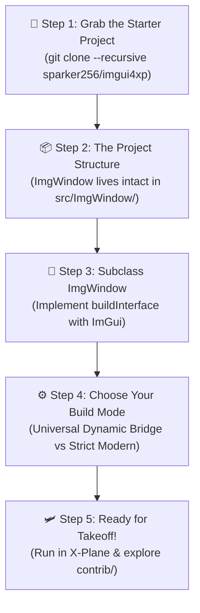

# TripTik 1: Get Started with ImgWindow v2

> [!TIP]
> **TripTik Navigation:**
> * 🧭 **[Ground-School.md](Ground-School.md)** *(Architecture Overview — read this first if you want the big picture)*
> * 🛫 **TripTik 1: Get Started with ImgWindow** *(You are here — starter guide for new C++ plugins or migrating from Lua/XPWidgets)*
> * 🚀 **[TripTik 2: Support Panel Graphics](Support-Panel-Graphics.md)** *(Upgrading an existing `ImgWindow` plugin to v2)*
> * 🖼️ **[TripTik 3: Render Custom Textures](Render-Custom-Textures.md)** *(Rendering `.png`/`.jpg` images via `CreateTexture()`)*

---

## 🗺️ Route Strip Map



---

## 🎯 Who This Guide Is For

This TripTik is the **turnkey on-ramp** for developers who want to build a modern, interactive 2D user interface inside X-Plane:

* **Starting a brand new C++ plugin** from scratch.
* **Graduating from Lua** (**`FlyWithLua`**, **`SASL`**, or **`XLua`**) to compile a standalone, high-performance C++ `.xpl` binary.
* **Escaping legacy `XPWidgets`**, replacing tedious pixel-math bounding boxes and callback trees with Dear ImGui's clean immediate-mode loop.
* **Existing plugin authors** who want a window framework that "just works" without writing a single line of OpenGL, Vulkan, Metal, or coordinate-conversion code.

> [!NOTE]
> **Prerequisites:**
> A standard C++11 (or later) compiler (Xcode on macOS, MSVC on Windows, GCC/Clang on Linux) and CMake 3.15+. Zero prior knowledge of OpenGL or X-Plane's internal graphics pipelines is required!

---

## 🛫 Step 1: Grab the Turnkey Starter Project (`imgui4xp`)

Writing a cross-platform X-Plane plugin from scratch requires boilerplate: downloading the X-Plane SDK headers, setting up CMake targets for Windows (`.xpl`), macOS (`.xpl` bundle), and Linux (`.xpl`), and exporting `XPluginStart`, `XPluginStop`, `XPluginEnable`, and `XPluginDisable`.

Rather than reinventing this wheel, the X-Plane community relies on Bill Good's ([@sparker256](https://github.com/sparker256)) canonical open-source template: **[`imgui4xp`](https://github.com/sparker256/imgui4xp)**.

```bash
# Clone the starter template WITH submodules (pulls down ImgWindow automatically!):
# (Note: --recurse-submodules and --recursive are exact synonyms in Git)
git clone --recurse-submodules https://github.com/sparker256/imgui4xp.git my-xplane-plugin
cd my-xplane-plugin
```

> [!TIP]
> If you already cloned the repository without `--recursive`, you can initialize the submodules at any time:
> ```bash
> git submodule update --init --recursive
> ```

`imgui4xp` provides the complete build scaffolding, CMake configuration, Dear ImGui core, and standard plugin entry points out of the box.

---

## 📦 Step 2: The Project Structure (Keep `ImgWindow` Whole!)

Because `ImgWindow` is tracked as a git submodule in `imgui4xp`, it already lives neatly inside `src/ImgWindow/`:

```text
my-xplane-plugin/
├── src/
│   ├── ImgWindow/                <-- Complete ImgWindow module (Core + contrib/)
│   │   ├── ImgWindow.h / .cpp    <-- Core window wrapper & dynamic bridge
│   │   ├── ImgFontAtlas.h / .cpp <-- Font management & glyph ranges
│   │   ├── contrib.h             <-- Master header for the contrib UX suite
│   │   └── contrib/              <-- Animated switches, wheel dials, tooltips, markdown
│   ├── imgui/                    <-- Dear ImGui core library
│   ├── imgui_starter_window.cpp  <-- Reference starter window (customize or replace)
│   ├── imgui_starter_window.h
│   ├── imgui4xp.cpp              <-- X-Plane plugin lifecycle entry points
│   └── CMakeLists.txt            <-- Complete cross-platform CMake build recipe
```

### Developing *In-Situ*
You develop your plugin directly inside this project tree:
* `src/CMakeLists.txt` is already configured for you! It includes `src/ImgWindow` in its header search paths:
  ```cmake
  # (Already in imgui4xp's CMakeLists.txt -- you do not need to add this yourself!)
  include_directories("${CMAKE_SOURCE_DIR}/ImgWindow")
  ```
  and compiles the core `ImgWindow` sources automatically:
  ```cmake
  # (Already in imgui4xp's CMakeLists.txt -- you do not need to add these yourself!)
  list(APPEND IMGUI4XP_SRCS
      ...
      ImgWindow/ImgFontAtlas.cpp
      ImgWindow/ImgWindow.cpp
  )
  ```
* You can customize the sample window in `imgui_starter_window.cpp` directly, or add your own window classes to `src/` and append them to `IMGUI4XP_SRCS` in `CMakeLists.txt`.

> [!WARNING]
> **Never Rip Out Loose Files!**
> Do **not** cherry-pick loose `.h` and `.cpp` files from `ImgWindow` and scatter them into your root `src/` folder. `ImgWindow` is an integrated package: keeping the `ImgWindow/` folder intact allows you to update cleanly via `git submodule update`, and gives your plugin instant access to the entire **[`contrib/` UX Suite](../../contrib/README.md)** (`#include "contrib.h"`).

> [!NOTE]
> **Adding to an Existing Plugin (Not Seeded from `imgui4xp`):**
> If you already have an established C++ plugin repository, the best practice is to add `ImgWindow` as a git submodule:
> ```bash
> git submodule add https://github.com/slgoldberg/ImgWindow.git src/ImgWindow
> ```
> In this case (since you aren't using `imgui4xp`'s preconfigured CMake file), you **must** configure your build manually:
> 1. Add `ImgWindow` to your compiler's header search paths:
>    ```cmake
>    include_directories("${CMAKE_SOURCE_DIR}/ImgWindow")
>    ```
> 2. Add both `ImgWindow.cpp` (and `ImgFontAtlas.cpp`) to your plugin's source file list in `CMakeLists.txt`:
>    ```cmake
>    list(APPEND YOUR_PLUGIN_SRCS
>        src/ImgWindow/ImgWindow.cpp
>        src/ImgWindow/ImgFontAtlas.cpp
>    )
>    ```
> *(Note: We show CMake directives for brevity throughout this guide, but you can configure the equivalent include paths, source files, and preprocessor definitions in GNU Make, Visual Studio, Xcode, Meson, or whichever build system your project uses).*

---

## 🎨 Step 3: Subclass `ImgWindow` (The Core Abstraction)

In `ImgWindow`, you never touch X-Plane's low-level window callbacks, coordinate transformations, or mouse event records. Instead, you create an object that inherits from `ImgWindow` and implement a single virtual method: **`buildInterface()`**.

### 1. Define Your Window Class

```cpp
#include "ImgWindow.h"

class FlightDeckSettingsWindow : public ImgWindow {
public:
    FlightDeckSettingsWindow(int left, int top, int right, int bottom)
        : ImgWindow(left, top, right, bottom, xplm_WindowDecorationRoundRectangle)
    {
        // Set the window title displayed in the X-Plane title bar
        SetWindowTitle("Flight Deck Settings");

        // Optional: Window styling & sizing constraints (minW, minH, maxW, maxH)
        SetWindowResizingLimits(320, 240, 1024, 768);
    }

protected:
    // This method is called automatically every frame your window is visible:
    void buildInterface() override {
        ImGui::TextUnformatted("Welcome to your first ImgWindow!");
        ImGui::Separator();

        // 1. A simple checkbox bound to a boolean variable
        static bool s_HudEnabled = true;
        ImGui::Checkbox("Enable Cockpit HUD", &s_HudEnabled);

        // 2. A slider bound to a float
        static float s_Brightness = 0.85f;
        ImGui::SliderFloat("Display Brightness", &s_Brightness, 0.0f, 1.0f, "%.0f%%");

        // 3. An action button
        if (ImGui::Button("Recalibrate Sensors")) {
            // Trigger your plugin systems logic here!
        }
    }
};
```

### 2. Instantiate and Open Your Window

In your plugin's main entry point (or inside a menu handler created via `XPLMAppendMenuItem`), instantiate your window pointer:

```cpp
#include <memory>

static std::unique_ptr<FlightDeckSettingsWindow> g_SettingsWindow;

// Called when the user clicks your plugin's menu item:
void ToggleSettingsWindow() {
    if (!g_SettingsWindow) {
        // Position: left = 100, top = 600, right = 500, bottom = 200 (in global sim coordinates)
        g_SettingsWindow = std::unique_ptr<FlightDeckSettingsWindow>(
            new FlightDeckSettingsWindow(100, 600, 500, 200)
        );
    }

    // Toggle visibility:
    bool isVisible = g_SettingsWindow->GetVisible();
    g_SettingsWindow->SetVisible(!isVisible);
}
```

> [!TIP]
> **Window Destruction Rule:**
> If the user clicks the "X" close box on your window, `ImgWindow` automatically hides the window (`SetVisible(false)`). You do not need to delete and recreate the C++ object every time it is closed—simply keep the instance alive and call `SetVisible(true)` when the user re-opens it.

---

## ⚙️ Step 4: Choose Your Build Mode (The One Decision)

Here is the secret of `ImgWindow v2`: **You never write graphics pipeline code.** 

Whether X-Plane is rendering via Vulkan on Windows, Metal on macOS, or legacy OpenGL on X-Plane 11, `ImgWindow` translates Dear ImGui's draw list into the appropriate driver commands invisibly.

The only decision you need to make is your target simulator compatibility in `CMakeLists.txt`:

```mermaid
flowchart TD
    Decision{"What X-Plane versions\ndo you want to support?"}

    Decision -->|"X-Plane 12.4.4+ AND\nX-Plane 11 / older XP12"| PathA["Option A (Recommended):\nUniversal Dynamic Bridge\n&#8209;DIMGWINDOW_USE_PANEL_GRAPHICS"]
    Decision -->|"X-Plane 12.4.4+ ONLY\n(Drop older simulators)"| PathB["Option B:\nStrict Modern Mode\n&#8209;DXPLM440=1"]
```



### Option A: The Universal Dynamic Bridge (Recommended)
This is the default configuration used by major commercial plugins. Your single compiled `.xpl` binary will automatically use **Panel Graphics** on X-Plane 12.4.4+ while safely falling back to **legacy OpenGL** on X-Plane 11 and older X-Plane 12 builds:

In your `CMakeLists.txt`:

```cmake
# Enable the Dynamic Bridge:
add_definitions(-DIMGWINDOW_USE_PANEL_GRAPHICS)
```

> [!WARNING]
> **The `XPLM440` CMake Trap:**
> Do **NOT** define `-DXPLM440=1` or `-DXPLM440=0` in your build configuration if you want backward compatibility! Setting `XPLM440` forces strict compile-time mode and strips out the legacy OpenGL fallback. To maintain compatibility with older X-Plane versions, target `-DXPLM430=1` (or lower) and let `IMGWINDOW_USE_PANEL_GRAPHICS` handle the runtime bridge.

### Option B: Strict Modern Panel Graphics (XP 12.4.4+ Only)
If your plugin is strictly for X-Plane 12.4.4 and later, and you have no intention of running on older simulators:

```cmake
add_definitions(-DXPLM440=1)
```

In this mode, all legacy OpenGL code paths are completely compiled out, producing a lean binary that talks directly to X-Plane's native Vulkan/Metal panel compositor.

---

## 🛩️ Step 5: Ready for Takeoff!

Compile your plugin, drop the resulting `.xpl` into your `X-Plane/Resources/plugins/` directory, and launch the simulator.

Look at X-Plane's `Log.txt` to verify `ImgWindow` initializing its graphics bridge:

```text
ImgWindow: Rendering via XPLM v4.4 Panel Graphics
```
*(On older simulator versions, it will automatically log: `ImgWindow: Rendering via Legacy OpenGL`).*

Open your menu item, and your Dear ImGui window will appear floating smoothly over the cockpit!

---

## 🧭 What's Next?

Now that your window infrastructure is rock-solid, where should you go next?

### 1. Elevate Your UI with `contrib/` (Cockpit-Grade Ergonomics)
Vanilla Dear ImGui was built for video game debug menus. To turn your window into a polished, commercial-grade flight instrument—with animated toggle switches, mouse-wheel dials and sliders, 1-click resets with undo, and stationary Markdown tooltips—check out the **[`contrib/` UX Suite](../../contrib/README.md)**. You can activate the entire suite in one line:

```cpp
#include "contrib.h" // Turnkey access to all widgets and extensions
```

### 2. Loading Custom `.png` / `.jpg` Images?
If your plugin loads custom icons, aircraft diagrams, or navigational maps to draw via `ImGui::Image()`, follow:
* 🖼️ **[TripTik 3: Render Custom Textures (`Render-Custom-Textures.md`)](Render-Custom-Textures.md)** to learn how `ImgWindow::CreateTexture()` lets you delete 100% of custom OpenGL texture code.

### 3. Upgrading an Existing v1 Plugin?
If you already maintain an older `ImgWindow` or `xsb_public` plugin and want to upgrade it to v2:
* 🚀 **[TripTik 2: Support Panel Graphics (`Support-Panel-Graphics.md`)](Support-Panel-Graphics.md)** walks through the 10-minute migration checklist.
