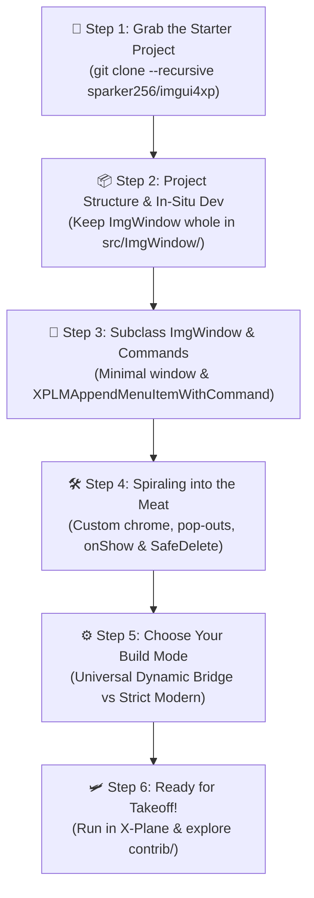

# TripTik 1: Get Started with ImgWindow v2

> [!TIP]
> **TripTik Navigation:**
> * 🧭 **[Ground-School.md](Ground-School.md)** *(Architecture Overview — read this first if you want the big picture)*
> * 🛫 **TripTik 1: Get Started with ImgWindow** *(You are here — starter guide for new C++ plugins or migrating from Lua/XPWidgets)*
> * 🚀 **[TripTik 2: Support Panel Graphics](Support-Panel-Graphics.md)** *(Upgrading an existing `ImgWindow` plugin to v2)*
> * 🖼️ **[TripTik 3: Render Custom Textures](Render-Custom-Textures.md)** *(Rendering `.png`/`.jpg` images via `CreateTexture()`)*

---

## 🗺️ Route Strip Map



---

## 🎯 Who This Guide Is For

This TripTik is the **turnkey on-ramp** for developers who want to build a modern, interactive 2D user interface inside X-Plane:

* **Starting a brand new C++ plugin** from scratch.
* **Graduating from Lua** (**`FlyWithLua`**, **`SASL`**, or **`XLua`**) to compile a standalone, high-performance C++ `.xpl` binary.
* **Escaping legacy `XPWidgets`**, replacing tedious pixel-math bounding boxes and callback trees with Dear ImGui's clean immediate-mode loop.
* **Existing plugin authors** who want a window framework that "just works" without writing a single line of OpenGL, Vulkan, Metal, or coordinate-conversion code.

> [!NOTE]
> **Prerequisites:**
> A standard C++11 (or later) compiler (Xcode on macOS, MSVC on Windows, GCC/Clang on Linux) and CMake 3.15+. Zero prior knowledge of OpenGL or X-Plane's internal graphics pipelines is required!

---

## 🛫 Step 1: Grab the Turnkey Starter Project (`imgui4xp`)

Writing a cross-platform X-Plane plugin from scratch requires boilerplate: downloading the X-Plane SDK headers, setting up CMake targets for Windows (`.xpl`), macOS (`.xpl` bundle), and Linux (`.xpl`), and exporting `XPluginStart`, `XPluginStop`, `XPluginEnable`, and `XPluginDisable`.

Rather than reinventing this wheel, the X-Plane community relies on Bill Good's ([@sparker256](https://github.com/sparker256)) canonical open-source template: **[`imgui4xp`](https://github.com/sparker256/imgui4xp)**.

```bash
# Clone the starter template WITH submodules (pulls down ImgWindow automatically!):
# (Note: --recurse-submodules and --recursive are exact synonyms in Git)
git clone --recurse-submodules https://github.com/sparker256/imgui4xp.git my-xplane-plugin
cd my-xplane-plugin
```

> [!TIP]
> If you already cloned the repository without `--recursive`, you can initialize the submodules at any time:
> ```bash
> git submodule update --init --recursive
> ```

`imgui4xp` provides the complete build scaffolding, CMake configuration, Dear ImGui core, and standard plugin entry points out of the box.

---

## 📦 Step 2: The Project Structure (Keep `ImgWindow` Whole!)

Because `ImgWindow` is tracked as a git submodule in `imgui4xp`, it already lives neatly inside `src/ImgWindow/`:

```text
my-xplane-plugin/
├── src/
│   ├── ImgWindow/                <-- Complete ImgWindow module (Core + contrib/)
│   │   ├── ImgWindow.h / .cpp    <-- Core window wrapper & dynamic bridge
│   │   ├── ImgFontAtlas.h / .cpp <-- Font management & glyph ranges
│   │   ├── contrib.h             <-- Master header for the contrib UX suite
│   │   └── contrib/              <-- Animated switches, wheel dials, tooltips, markdown
│   ├── imgui/                    <-- Dear ImGui core library
│   ├── imgui_starter_window.cpp  <-- Reference starter window (customize or replace)
│   ├── imgui_starter_window.h
│   ├── imgui4xp.cpp              <-- X-Plane plugin lifecycle entry points
│   └── CMakeLists.txt            <-- Complete cross-platform CMake build recipe
```

### Developing *In-Situ*
You develop your plugin directly inside this project tree:
* `src/CMakeLists.txt` is already configured for you! It includes `src/ImgWindow` in its header search paths:
  ```cmake
  # (Already in imgui4xp's CMakeLists.txt -- you do not need to add this yourself!)
  include_directories("${CMAKE_SOURCE_DIR}/ImgWindow")
  ```
  and compiles the core `ImgWindow` sources automatically:
  ```cmake
  # (Already in imgui4xp's CMakeLists.txt -- you do not need to add these yourself!)
  list(APPEND IMGUI4XP_SRCS
      ...
      ImgWindow/ImgFontAtlas.cpp
      ImgWindow/ImgWindow.cpp
  )
  ```
* You can customize the sample window in `imgui_starter_window.cpp` directly, or add your own window classes to `src/` and append them to `IMGUI4XP_SRCS` in `CMakeLists.txt`.

> [!WARNING]
> **Never Rip Out Loose Files!**
> Do **not** cherry-pick loose `.h` and `.cpp` files from `ImgWindow` and scatter them into your root `src/` folder. `ImgWindow` is an integrated package: keeping the `ImgWindow/` folder intact allows you to update cleanly via `git submodule update`, and gives your plugin instant access to the entire **[`contrib/` UX Suite](../../contrib/README.md)** (`#include "contrib.h"`).

> [!NOTE]
> **Adding to an Existing Plugin (Not Seeded from `imgui4xp`):**
> If you already have an established C++ plugin repository, the best practice is to add `ImgWindow` as a git submodule:
> ```bash
> git submodule add https://github.com/slgoldberg/ImgWindow.git src/ImgWindow
> ```
> In this case (since you aren't using `imgui4xp`'s preconfigured CMake file), you **must** configure your build manually:
> 1. Add `ImgWindow` to your compiler's header search paths:
>    ```cmake
>    include_directories("${CMAKE_SOURCE_DIR}/ImgWindow")
>    ```
> 2. Add both `ImgWindow.cpp` (and `ImgFontAtlas.cpp`) to your plugin's source file list in `CMakeLists.txt`:
>    ```cmake
>    list(APPEND YOUR_PLUGIN_SRCS
>        src/ImgWindow/ImgWindow.cpp
>        src/ImgWindow/ImgFontAtlas.cpp
>    )
>    ```
> *(Note: We show CMake directives for brevity throughout this guide, but you can configure the equivalent include paths, source files, and preprocessor definitions in GNU Make, Visual Studio, Xcode, Meson, or whichever build system your project uses.)*

---

## 🎨 Step 3: Subclass `ImgWindow` & Modern Command Dispatch

In `ImgWindow`, you never touch X-Plane's low-level window callbacks, coordinate transformations, or raw mouse/keyboard event records. Instead, you create a C++ class that inherits from `ImgWindow`.

### 1. The Minimal "Hello, World" Starter Window

Let's begin with the simplest possible window subclass. To get pixels rendering on screen, you only need to override one pure-virtual method: **`buildInterface()`**.

```cpp
#include "ImgWindow.h"

class PluginSettingsWindow : public ImgWindow {
public:
    // Centered automatically on the primary monitor (480 x 320 boxels)
    PluginSettingsWindow()
        : ImgWindow(480, 320, xplm_WindowDecorationRoundRectangle)
    {
        // Set the window title displayed in the X-Plane title bar
        SetWindowTitle("Plugin Settings");

        // Optional: Window sizing constraints (minW, minH, maxW, maxH)
        SetWindowResizingLimits(320, 200, 1024, 768);
    }

protected:
    // Required: Called automatically every frame your window is visible:
    void buildInterface() override {
        ImGui::TextUnformatted("Hello, World from ImgWindow!");
        ImGui::Separator();

        if (ImGui::Button("Click Me")) {
            // Handle your action here!
        }
    }
};
```

> [!TIP]
> **Flexible Window Geometry & Positioning (`WindowGeometry`)**:
> In `ImgWindow v2.2+`, you can construct windows using whichever positioning paradigm best fits your plugin:
> * **Auto-Centered (Fastest & Simplest)**:
>   `ImgWindow(width, height)` — centers automatically on the primary monitor with zero coordinate math (very similar to FlyWithLua's window creation!).
> * **Top-Left Origin (Familiar 2D Desktop Math)**:
>   `ImgWindow(WindowGeometry::FromTopLeft(x, y, width, height))` — eliminates inverted $Y$ coordinate headaches.
> * **Saved Settings (.ini) with Auto-Docking**:
>   `ImgWindow(WindowGeometry::Sanitize(savedL, savedT, savedR, savedB))` — guarantees windows never spawn off-screen if monitors or resolutions change, while preserving "poor-man's docking" margins.
> * **Legacy Raw Boxels**:
>   `ImgWindow(left, top, right, bottom)` — 100% backward-compatible with legacy plugins.


---

### 2. "Commands for Everything" (Modern Command-First Dispatching)

Now that you have a window class, how should your plugin open and close it?

In older tutorials, you might see authors call `XPLMAppendMenuItem()` to create a bare menu item that opens a window. **In modern X-Plane development, do not do this.** 

The canonical, best-practice pattern is **"Commands for Everything"** using **`XPLMAppendMenuItemWithCommand()`**:

1. **Automatic Shortcut Display**: When a user assigns a keyboard key or joystick button to your command in X-Plane's Settings, X-Plane automatically prints their custom hotkey directly inside your plugin's menu item!
2. **Universal Accessibility**: External scripts (such as `FlyWithLua`), hardware cockpit panels (StreamDecks, custom switch panels), and other plugins can trigger your command directly via `XPLMCommandOnce(...)`.
3. **Single Source of Truth**: You write **one** command handler that toggles window visibility. Your menu item simply points to that command—eliminating redundant menu callbacks and state synchronization.

Here is the turnkey pattern to register your command and menu item:

```cpp
#include <memory>
#include "XPLMUtilities.h"
#include "XPLMMenus.h"

// 1. Static pointers for our window instance and registered command:
static std::unique_ptr<PluginSettingsWindow> g_SettingsWindow;
static XPLMCommandRef g_ToggleSettingsCmd = nullptr;

// 2. The Command Handler: Toggles window visibility on demand:
static int ToggleSettingsCommandHandler(XPLMCommandRef inCommand,
                                        XPLMCommandPhase inPhase,
                                        void* inRefcon)
{
    // Execute on key-down / command start:
    if (inPhase == xplm_CommandBegin) {
        if (!g_SettingsWindow) {
            // Lazy instantiation on first invocation (auto-centered at 480x320):
            g_SettingsWindow = std::unique_ptr<PluginSettingsWindow>(
                new PluginSettingsWindow()
            );
        }

        // Toggle visibility:
        bool isVisible = g_SettingsWindow->GetVisible();
        g_SettingsWindow->SetVisible(!isVisible);
    }
    return 0; // 0 = we own and consume this command across all phases
}

> [!TIP]
> **Why `return 0;`? The Phase Consistency Rule:**
> In X-Plane command handlers, returning `0` signals that your plugin has consumed the command. To prevent X-Plane's internal dispatch tables from going out of sync across key-press and key-release events, you must return the **same value across all phases** (`Begin`, `Continue`, `End`).
> 
> For advanced patterns—including continuous held commands with acceleration curves, multi-command multiplexing, and hardware switch integration—see the in-depth guide in [**Ground School: The Command System**](Ground-School.md#the-command-system-how-modern-x-plane-plugins-dispatch-actions).


// 3. In your XPluginEnable() entry point:
PLUGIN_API int XPluginEnable(void) {
    // A. Create the command:
    g_ToggleSettingsCmd = XPLMCreateCommand(
        "my_plugin/toggle_settings",
        "Toggle Settings Window"
    );

    // B. Register our command handler:
    XPLMRegisterCommandHandler(
        g_ToggleSettingsCmd,
        ToggleSettingsCommandHandler,
        1,       // 1 = execute before X-Plane
        nullptr  // optional refcon
    );

    // C. Bind the command directly to your plugin's menu:
    XPLMMenuID pluginsMenu = XPLMFindPluginsMenu();
    XPLMAppendMenuItemWithCommand(
        pluginsMenu,
        "My Plugin Settings",
        g_ToggleSettingsCmd
    );

    return 1;
}

// 4. In your XPluginDisable() entry point:
PLUGIN_API void XPluginDisable(void) {
    // Unregister command handler on shutdown:
    if (g_ToggleSettingsCmd) {
        XPLMUnregisterCommandHandler(
            g_ToggleSettingsCmd,
            ToggleSettingsCommandHandler,
            1,
            nullptr
        );
    }

    // Clean up window instance:
    g_SettingsWindow.reset();
}
```

> [!TIP]
> **Window Lifecycle Rule:**
> When the user closes your window, `ImgWindow` automatically hides it (`SetVisible(false)`). You do **not** need to delete and recreate the C++ object every time it is closed! Keep the instance alive and simply call `SetVisible(true)` when reopened.

---

## 🛠️ Step 4: Spiraling into the Meat (Custom Chrome, Pop-Outs & Lifecycle Hooks)

Once your minimal window is up and running, real-world plugins quickly demand more: custom title bars with drag handles, OS pop-out support, visibility guards, and safe self-destruction.

### The Lifecycle Container

`ImgWindow` acts as a complete lifecycle container with several optional hooks:

* **`buildInterface()` (Required)**: Called every frame your window is visible to construct widgets and dispatch plugin logic.
* **`onShow()` (Optional)**: Called immediately before the window becomes visible. Return `false` to suppress display (e.g. if required systems or avionics power are offline).
* **`beforeBegin()` (Optional)**: Called right before `ImGui::Begin()`. Return custom `ImGuiWindowFlags_` (such as `ImGuiWindowFlags_NoTitleBar` or `ImGuiWindowFlags_MenuBar`).
* **`afterRendering()` (Optional)**: Called after Dear ImGui finishes drawing, right before X-Plane's window draw callback returns.
* **`mFirstRender` (Protected Flag)**: A built-in boolean guard you can check inside `buildInterface()` to perform one-time setup (like default table column widths or initial focus) on the very first frame.
* **`SafeDelete()`**: Schedules deferred self-destruction of the window instance from within its own event handlers or click callbacks, safely deleting the object at the flight loop boundary without dangling pointers.

---

### Production-Ready Window Implementation

Here is a complete, real-world window demonstrating custom title bar chrome (drag handle, pop-out button, close button), `onShow()` validation, and `SafeDelete()`:

```cpp
#include "ImgWindow.h"
#include "contrib.h" // Turnkey access to Markdown, TimedTooltip, and MouseWheel controls

class PluginSettingsWindow : public ImgWindow {
public:
    // Construct with a WindowGeometry parameter object (auto-centered by default, or sanitized from .ini):
    PluginSettingsWindow(const WindowGeometry& geometry = WindowGeometry::Centered(480, 320))
        // Use self-decorated resizable mode for custom window chrome:
        : ImgWindow(geometry, xplm_WindowDecorationSelfDecoratedResizable)
    {
        SetWindowTitle("Plugin Settings");
        SetWindowResizingLimits(360, 240, 1024, 768);

        // 1. Define a drag strip across the top (left = 0, top = 0, right = INT_MAX, bottom = 28)
        // Enables left-click window dragging without an OS title bar!
        SetWindowDragArea(0, 0, INT_MAX, 28);

        // 2. Flight loop callback to safely defer window mode changes outside drawing:
        XPLMCreateFlightLoop_t flDef = {
            sizeof(flDef),
            xplm_FlightLoop_Phase_BeforeFlightModel,
            FlightLoopCallback,
            this
        };
        mFlightLoopId = XPLMCreateFlightLoop(&flDef);
    }

    ~PluginSettingsWindow() override {
        if (mFlightLoopId) {
            XPLMDestroyFlightLoop(mFlightLoopId);
            mFlightLoopId = nullptr;
        }
    }

protected:
    // Optional: Intercept visibility. Return false to abort opening!
    bool onShow() override {
        // Real-world example: Verify that required plugin systems or avionics power
        // are online before allowing the window to pop up:
        // if (XPLMGetDatai(g_AvionicsOnRef) == 0) {
        //     return false; // Suppress display -- window stays hidden!
        // }
        return true; // Allow display
    }

    // Optional: Inject ImGui window flags before ImGui::Begin():
    ImGuiWindowFlags_ beforeBegin() override {
        // Clean borderless window without default ImGui collapse or title bar:
        return (ImGuiWindowFlags_)(ImGuiWindowFlags_NoCollapse | ImGuiWindowFlags_NoTitleBar);
    }

    // Required: Called every frame the window is visible:
    void buildInterface() override {
        // Step 1: Draw custom window chrome at the top:
        drawCustomTitleBar();

        // Step 2: Main UI content using contrib/ widgets:
        ImGui::MD::Text("# Plugin Quick Settings\nPlugin services and background telemetry are **active**.");
        ImGui::Separator();

        static bool s_TelemetryEnabled = true;
        ImGui::Checkbox("Enable High-Rate Telemetry", &s_TelemetryEnabled);
        ImGui::TimedTooltip::Text("Only appears on an intentional hover pause -- won't flash when sweeping past!");

        static float s_Scale = 1.0f;
        ImGui::MouseWheelSlider("UI Scale Factor", &s_Scale, 0.5f, 2.0f, "%.2fx");
        ImGui::TimedTooltip::Text("Hover and scroll your mouse wheel. Anchors cleanly and dismisses after reading.");

        ImGui::Spacing();
        ImGui::Separator();

        // Step 3: Deferred self-destruction example:
        if (ImGui::Button("Unload Plugin Window")) {
            SafeDelete(); // Schedules safe deletion at the next flight loop boundary!
        }
        ImGui::TimedTooltip::Text("Safely destroys the C++ window instance without crashing the active draw loop.");
    }

private:
    XPLMFlightLoopID mFlightLoopId = nullptr;
    XPLMWindowPositioningMode mPendingMode = (XPLMWindowPositioningMode)-1;

    // Deferred mode switcher: Changing OS window hierarchy in the middle of active
    // ImGui drawing can cause driver crashes. Deferring to a flight loop is the gold standard!
    static float FlightLoopCallback(float, float, int, void* inRefcon) {
        auto* self = static_cast<PluginSettingsWindow*>(inRefcon);
        if (self && self->mPendingMode != (XPLMWindowPositioningMode)-1) {
            self->SetWindowPositioningMode(self->mPendingMode);
            self->mPendingMode = (XPLMWindowPositioningMode)-1;
        }
        return 0.0f; // 0.0f = do not repeat (one-shot execution)
    }

    void scheduleModeChange(XPLMWindowPositioningMode newMode) {
        mPendingMode = newMode;
        if (mFlightLoopId) {
            XPLMScheduleFlightLoop(mFlightLoopId, -1.0f, 1); // Trigger on next frame
        }
    }

    void drawCustomTitleBar() {
        // 1. Title Text
        ImGui::TextUnformatted("Plugin Settings");

        // 2. Drag handle grip lines (subtle 3-line visual indicator):
        ImGui::SameLine();
        ImDrawList* dl = ImGui::GetWindowDrawList();
        ImVec2 start = ImGui::GetCursorScreenPos();
        float availX = ImGui::GetContentRegionAvail().x;
        float gripWidth = availX - 110.0f; // Leave room for Pop-Out and Close buttons

        if (gripWidth > 20.0f) {
            start.y += 6.0f;
            for (int i = 0; i < 3; ++i) {
                dl->AddLine(start, ImVec2(start.x + gripWidth, start.y), IM_COL32(160, 160, 160, 180), 1.0f);
                start.y += 4.0f;
            }
        }

        // 3. Pop-Out / Pop-In & Close Buttons:
        // (If you use imgui4xp, IconsFontAwesome5.h provides crisp vector icons out of the box!)
#if defined(ICON_FA_WINDOW_MAXIMIZE)
        const char* btnPopOut = ICON_FA_WINDOW_MAXIMIZE;
        const char* btnPopIn  = ICON_FA_WINDOW_RESTORE;
        const char* btnClose  = ICON_FA_WINDOW_CLOSE;
        const float rightOffset = 65.0f;
#else
        const char* btnPopOut = "Pop Out";
        const char* btnPopIn  = "Pop In";
        const char* btnClose  = "X";
        const float rightOffset = 105.0f;
#endif

        ImGui::SameLine(ImGui::GetWindowWidth() - rightOffset);
        if (IsPoppedOut()) {
            if (ImGui::SmallButton(btnPopIn)) {
                scheduleModeChange(xplm_WindowPositionFree);
            }
            ImGui::TimedTooltip::Text("Move this window back inside the X-Plane simulator");
        } else {
            if (ImGui::SmallButton(btnPopOut)) {
                scheduleModeChange(xplm_WindowPopOut);
            }
            ImGui::TimedTooltip::Text("Pop out into an independent operating system window");
        }

        // 4. Close Button:
        ImGui::SameLine();
        if (ImGui::SmallButton(btnClose)) {
            SetVisible(false); // Simply hide the window
        }
        ImGui::TimedTooltip::Text("Close this window");

        ImGui::Separator();
    }
};
```

> [!TIP]
> **Built-in Font Awesome Icons in `imgui4xp`:**
> If you seeded your project from `imgui4xp` (Step 1), you don't have to settle for plain text `"Pop Out"` or `"X"` buttons! `imgui4xp` already bundles **Font Awesome 5** (`IconsFontAwesome5.h`) and automatically merges standard icons into `ImgWindow::sFontAtlas` during startup (in `imgui_starter_window.cpp`'s `configureImgWindow()`).
> 
> Simply `#include "IconsFontAwesome5.h"` to use crisp vector icons directly:
> * `ICON_FA_WINDOW_MAXIMIZE` — Standard OS pop-out icon
> * `ICON_FA_WINDOW_RESTORE` — Standard return-to-sim / pop-in icon
> * `ICON_FA_WINDOW_CLOSE` (or `ICON_FA_TIMES`) — Standard "X" close icon
> * `ICON_FA_EXTERNAL_LINK_SQUARE_ALT` — Move window to VR headset

---

### Notice the Extended UI Controls?

In the example above, you might notice a few widgets that don't exist in vanilla Dear ImGui:

* **`ImGui::MD::Text(...)`** (or **`ImGui::Markdown::Text(...)`**): Renders headers, bold emphasis, and bullet lists directly using standard Markdown syntax—matching standard `ImGui::Text()` layout without custom string parsing. (`MD` is the official shorthand alias for `Markdown`.)
* **`ImGui::TimedTooltip::Text(...)`**: Classic desktop-style tooltips that behave politely. Unlike default ImGui tooltips (which pop up instantly on first contact and follow your cursor around like an annoying swarm of gnats), `TimedTooltip` waits for an intentional hover pause before appearing, locks into a stationary position so it is easy to read, and automatically dismisses after reading so it never stays permanently stuck on screen obstructing your view.
* **`ImGui::MouseWheelSlider(...)`**: Sliders and dials that respond naturally to mouse-wheel scrolling without awkward click-dragging.

These widgets are part of `ImgWindow`'s bundled **[`contrib/` UX Suite](../../contrib/README.md)**. If you want to use them in your window, simply include `#include "contrib.h"`. (If you prefer 100% vanilla Dear ImGui, standard `ImGui::Text()`, `ImGui::SliderFloat()`, and `ImGui::SetItemTooltip()` work identically.)

---

## ⚙️ Step 5: Choose Your Build Mode (The One Decision)

Here is the secret of `ImgWindow v2`: **You never write graphics pipeline code.** 

Whether X-Plane is rendering via Vulkan on Windows, Metal on macOS, or legacy OpenGL on X-Plane 11, `ImgWindow` translates Dear ImGui's draw list into the appropriate driver commands invisibly.

The only decision you need to make is your target simulator compatibility in `CMakeLists.txt`:

```mermaid
flowchart TD
    Decision{"What X-Plane versions\ndo you want to support?"}

    Decision -->|"X-Plane 12.4.4+ AND\nX-Plane 11 / older XP12"| PathA["Option A (Recommended):\nUniversal Dynamic Bridge\n&#8209;DIMGWINDOW_USE_PANEL_GRAPHICS"]
    Decision -->|"X-Plane 12.4.4+ ONLY\n(Drop older simulators)"| PathB["Option B:\nStrict Modern Mode\n&#8209;DXPLM440=1"]
```



### Option A: The Universal Dynamic Bridge (Recommended)
This is the default configuration used by major commercial plugins. Your single compiled `.xpl` binary will automatically use **Panel Graphics** on X-Plane 12.4.4+ while safely falling back to **legacy OpenGL** on X-Plane 11 and older X-Plane 12 builds:

In your `CMakeLists.txt`:

```cmake
# Enable the Dynamic Bridge:
add_definitions(-DIMGWINDOW_USE_PANEL_GRAPHICS)
```

> [!WARNING]
> **The `XPLM440` CMake Trap:**
> Do **NOT** define <nobr><code>&#8209;DXPLM440=1</code></nobr> or <nobr><code>&#8209;DXPLM440=0</code></nobr> in your build configuration if you want backward compatibility! Setting `XPLM440` forces strict compile-time mode and strips out the legacy OpenGL fallback. To maintain compatibility with older X-Plane versions, target <nobr><code>&#8209;DXPLM430=1</code></nobr> (or lower) and let <nobr><code>&#8209;DIMGWINDOW_USE_PANEL_GRAPHICS</code></nobr> handle the runtime bridge.

### Option B: Strict Modern Panel Graphics (XP 12.4.4+ Only)
If your plugin is strictly for X-Plane 12.4.4 and later, and you have no intention of running on older simulators:

```cmake
add_definitions(-DXPLM440=1)
```

In this mode, all legacy OpenGL code paths are completely compiled out, producing a lean binary that talks directly to X-Plane's native Vulkan/Metal panel compositor.

---

## 🛩️ Step 6: Ready for Takeoff!

Compile your plugin, drop the resulting `.xpl` into your `X-Plane/Resources/plugins/` directory, and launch the simulator.

Look at X-Plane's `Log.txt` to verify `ImgWindow` initializing its modern graphics bridge:

```text
ImgWindow v2.2.1: [YourPlugin] using Panel Graphics for ImGui rendering.
```
*(On older simulator versions without Panel Graphics support, `ImgWindow` falls back to its legacy OpenGL pipeline and logs the reason.)*

Trigger your command (or click your menu item), and your Dear ImGui window will appear floating smoothly in the simulator!

---

## 🧭 What's Next?

Now that your window infrastructure is rock-solid, where should you go next?

### 1. Elevate Your UI with `contrib/` (Enhanced UI Ergonomics)
Vanilla Dear ImGui was built for video game debug menus. To turn your window into a polished, desktop-grade interface—with animated toggle switches, mouse-wheel dials and sliders, 1-click resets with undo, and stationary Markdown tooltips—check out the **[`contrib/` UX Suite](../../contrib/README.md)**. You can activate the entire suite in one line:

```cpp
#include "contrib.h" // Turnkey access to all widgets and extensions
```

### 2. Upgrading an Existing v1 Plugin?
If you already maintain an older `ImgWindow` or `xsb_public` plugin and want to upgrade it to v2:
* 🚀 **[TripTik 2: Support Panel Graphics (`Support-Panel-Graphics.md`)](Support-Panel-Graphics.md)** walks through the 10-minute migration checklist.

### 3. Loading Custom `.png` / `.jpg` Images?
If your plugin loads custom icons, aircraft diagrams, or navigational maps to draw via `ImGui::Image()`, follow:
* 🖼️ **[TripTik 3: Render Custom Textures (`Render-Custom-Textures.md`)](Render-Custom-Textures.md)** to learn how `ImgWindow::CreateTexture()` lets you delete 100% of custom OpenGL texture code.

