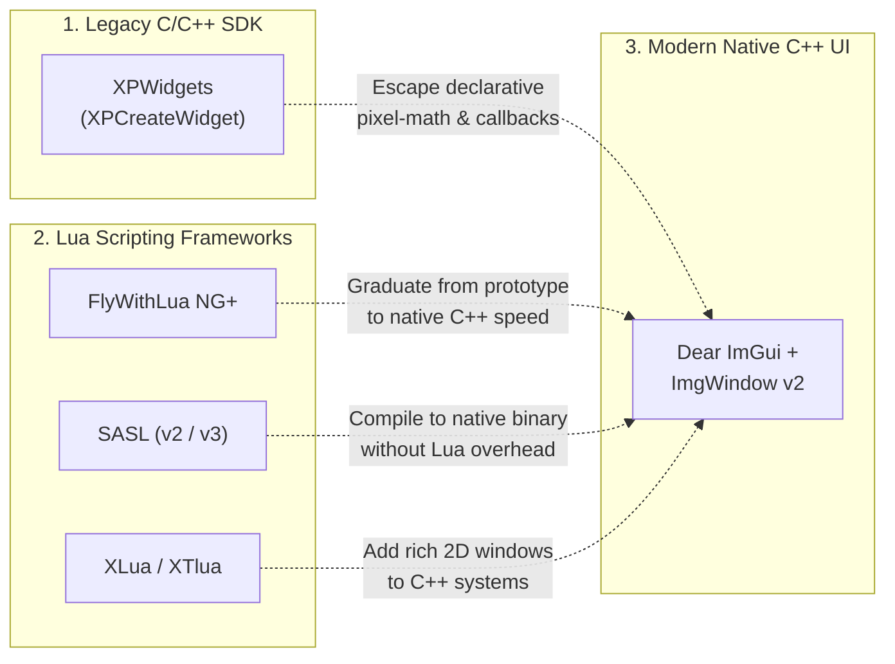
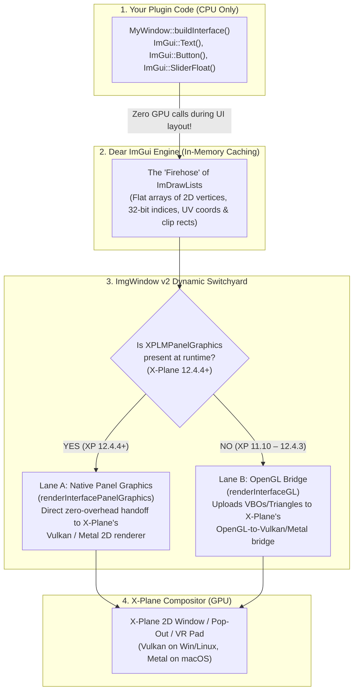

# Ground School: How Dear ImGui, ImgWindow v2, and X-Plane Fit Together

> [!TIP]
> **How to use this guide:**
> This document is the **"Regional Overview Map"** for the [`docs/how-to/`](README.md) TripTik series. It explains the big-picture architecture—with zero code changes required yet—so that nothing in the step-by-step guides feels like "black magic."
>
> **Already know the lay of the land?** Jump straight to your turn-by-turn TripTik:
> * 🛫 **[TripTik 1: Get Started with ImgWindow](Get-Started-With-ImgWindow.md)** *(New C++ plugin, or moving from `XPWidgets`, `FlyWithLua`, `SASL`, or `XLua`)*
> * 🚀 **[TripTik 2: Support Panel Graphics](Support-Panel-Graphics.md)** *(Upgrading an existing `ImgWindow` plugin to `ImgWindow v2`)*
> * 🖼️ **[TripTik 3: Render Custom Textures](Render-Custom-Textures.md)** *(Deleting custom OpenGL `glTexImage2D` / `SystemGL.h` code for `.png`/`.jpg` images)*

---

## 1. The X-Plane Plugin UI Landscape: How We Got Here

If you have built X-Plane plugins (or aircraft scripts) over the years, you have probably encountered X-Plane's historic UI dilemma: **how do you build a rich, modern, interactive 2D window inside the simulator?**

Historically, developers had to choose between two extremes:



1. **The Legacy C API (`XPWidgets`):**
   For decades, the only official UI toolkit bundled in the X-Plane SDK was **`XPWidgets`** (`XPWidgets.h` / `XPStandardWidgets.h`). Because it is a 1990s-style *retained-mode, declarative* C API, building even a simple settings window requires manually computing pixel bounding boxes (`left, top, right, bottom`) for every label, button, and scrollbar, creating a tree of widget handles via `XPCreateWidget()`, and wiring up giant `XPWidgetFunc_t` event-loop callbacks to intercept `xpMsg_PushButtonPressed` and `xpMsg_ScrollBarSliderPositionChanged` messages.
2. **Lua Frameworks (`FlyWithLua`, `SASL`, `XLua`):**
   Many developers turned to Lua frameworks—such as **FlyWithLua NG+** (which introduced built-in Dear ImGui bindings for scripts) or **SASL** (*Scriptable Aviation Simulation Library*, widely used in commercial add-ons in part for its source-code obfuscation/encryption)—while aircraft authors used Laminar's minimalist **XLua** for headless systems logic. Lua is fantastic for rapid prototyping, but as a plugin grows in complexity, developers often hit the ceiling of interpreted Lua performance, dependency management, or SDK access and want to compile a self-contained, native C++ plugin (`.xpl`).

### Why Laminar Doesn't Ship a C++ ImGui Wrapper—And Where `ImgWindow` Fits In

When **Dear ImGui** (Omar Cornut's immediate-mode C++ graphical user interface library) took the graphics world by storm, X-Plane developers—and Laminar Research itself—realized it was the perfect fit for simulator tools and windows.

Rather than inventing another proprietary widget library to replace `XPWidgets`, Laminar made a smart architectural split:
* **Laminar Research provides the low-level windowing and GPU rendering hooks** in the X-Plane SDK (`XPLMDisplay`'s Modern Windows API and `XPLMPanelGraphics`).
* **Open-source C++ frameworks like `ImgWindow` provide the bridge** that connects Dear ImGui's immediate-mode UI loop to X-Plane's windows, coordinate systems (including VR and multi-monitor DPI scaling), mouse/keyboard input, and rendering pipelines.

### Immediate-Mode vs. Declarative UI at a Glance

If you are coming from `XPWidgets`, the shift to Dear ImGui inside an `ImgWindow` subclass feels like taking off ankle weights. Instead of declaring widget trees during startup and passing messages back and forth, **your UI code simply runs top-to-bottom inside your window's `buildInterface()` draw loop whenever your window is visible** (managed seamlessly by `ImgWindow`'s lifecycle container alongside `onShow()`, `beforeBegin()`, and `afterRendering()` hooks):

```cpp
// Inside your ImgWindow subclass:
void MySettingsWindow::buildInterface() {
    ImGui::TextUnformatted("Camera Field of View:");

    // One line draws the slider, handles mouse/keyboard input, AND updates mFov!
    if (ImGui::SliderFloat("FOV (degrees)", &mFov, 40.0f, 120.0f, "%.1f deg")) {
        XPLMSetDataf(mFovDataRef, mFov); // Only runs on the exact frame the user moves the slider
    }
}
```

---

## 2. What Is `ImgWindow v2`? (More Than Just Panel Graphics!)

For years, the original `ImgWindow` (created by Christopher Collins / `@kuroneko` as part of `xsb_public`) was passed around the X-Plane C++ community like an oral tradition. Developers copied a snapshot of `ImgWindow.h` and `ImgWindow.cpp` into their repositories—including Bill Good's (`@sparker256`) popular [`imgui4xp`](https://github.com/sparker256/imgui4xp) starter template, `LiveTraffic`, `xPilot`, and `A-Better-Camera (ABC)`—and fixed bugs or added features in isolated forks.

**`ImgWindow v2` (v2.0 / v2.1+)** is the unified, modernized roll-up of that entire lineage into a single, drop-in repository:

| Pillar | What `ImgWindow v2` Gives You Out of the Box |
| :--- | :--- |
| **1. Community Roll-Up** | Incorporates years of community fixes and enhancements across known `ImgWindow` forks (VR window attach/detach handling, boxel/HiDPI scaling, window positioning/gravity helpers, safe popup closure, and Dear ImGui v1.89.7+ / v1.92+ compatibility). |
| **2. Native Panel Graphics + Backward Compatibility** | Automatically renders via X-Plane 12.4.4+'s native **Panel Graphics (`XPLMPanelGraphics`)** pipeline when available, while falling back to OpenGL at runtime on X-Plane 11.10–12.4.3—**from a single compiled `.xpl` binary**. |
| **3. Zero-OpenGL Texture Management** | Built-in `ImgWindow::CreateTexture()` and `ImgWindow::DeleteTexture()` APIs let you render `.png`/`.jpg` images via `ImGui::Image()` without writing a single line of OpenGL code. |
| **4. Optional `contrib/` Suite** | A header-only collection (`#include "contrib/includes.h"`) of X-Plane-ready ImGui widgets and extensions: mouse-wheel sliders/combos with 1-click Reset/Undo, Markdown rendering (`ImGui::MD`), clickable links, stationary sticky-note `TimedTooltip`s, and toggle buttons. |

---

## 3. Under the Hood: The `ImDrawList` "Firehose" & Why Dual-Backend Support Isn't Magic

Many long-time `ImgWindow` users never even knew their plugin was using OpenGL under the hood—they just subclassed `ImgWindow`, configured an `ImgFontAtlas`, and wrote `ImGui::*` calls.

So how does Dear ImGui actually put pixels on the screen inside X-Plane, and why can `ImgWindow v2` support **both** legacy OpenGL and modern Panel Graphics in the same binary without changing a single line of your UI code?

### Step-by-Step: What Happens During One X-Plane UI Frame



1. **Your UI Code Does Zero GPU Work (`buildInterface()`):**
   When X-Plane is in its 2D UI drawing phase and calls your window to draw, Dear ImGui runs your `buildInterface()` function. Thanks to Dear ImGui's immediate-mode design and aggressive internal layout caching, calling `ImGui::Button()` or `ImGui::Text()` does **not** talk to OpenGL, Vulkan, or Metal. It simply calculates 2D rectangles and appends colored triangles and font UV coordinates into an in-memory buffer called an **`ImDrawList`**.
2. **The `ImDrawList` "Firehose":**
   At the end of your window's frame, Dear ImGui hands `ImgWindow` a "firehose" of `ImDrawList` payloads—essentially flat C arrays of 2D vertices (`x, y, u, v, rgba`), 32-bit triangle indices, and texture/clip-rectangle commands.
3. **Two High-Efficiency Receptacles for the Same Firehose:**
   Ever since X-Plane 11.50 and X-Plane 12, X-Plane's core rendering engine has run on **Vulkan** (Windows/Linux) and **Metal** (macOS). How does that engine ingest `ImgWindow`'s `ImDrawList` firehose?
   * **Receptacle 1 — X-Plane's OpenGL Bridge (XP 11.10 through XP 12.x):**
     Laminar Research invested heavily in open-source and custom OpenGL translation layers so that plugins emitting standard OpenGL draw calls (`glDrawElementsBaseVertex`) are ingested into X-Plane's Vulkan/Metal pipeline during render time. It works well, but it still requires setting up and tearing down an OpenGL state machine every frame.
   * **Receptacle 2 — Native Panel Graphics (`XPLMPanelGraphics`, XP 12.4.4+):**
     Laminar recognized that almost every modern C++ plugin UI is powered by Dear ImGui's `ImDrawList` firehose. So in X-Plane 12.4.4 (SDK 4.2.0 / `XPLM420`), they introduced **Panel Graphics**—a rendering API shaped *specifically* as a direct, native receptacle for Dear ImGui vertex and index buffers! It bypasses the OpenGL state machine completely and hands your `ImDrawList` arrays straight to X-Plane's native Vulkan/Metal compositor.
4. **Why Dual-Backend Support Isn't "Pure Magic":**
   Because your `buildInterface()` code and Dear ImGui's `ImDrawList` firehose are **100% identical** regardless of which receptacle catches them at the bottom, `ImgWindow v2` simply checks at runtime (via `XPLMFindSymbol`) whether X-Plane's Panel Graphics receptacle exists:
   * On **X-Plane 12.4.4+**, `ImgWindow v2` pours the `ImDrawList` firehose directly into **Panel Graphics**.
   * On **older X-Plane 12 or X-Plane 11**, `ImgWindow v2` pours the exact same firehose into the **OpenGL Bridge**.

---

## 4. What About Custom Images (`.png` / `.jpg`)?

There is only **one** place where a plugin author's own code ever needed to care about the graphics backend: **loading custom textures** (such as displaying a `.png` diagram or `.jpg` icon via `ImGui::Image()`).

Historically, `ImgWindow` v1 only managed the **Font Atlas texture** for you. If you wanted to draw your own image, you had to include `#include "SystemGL.h"`, call `XPLMGenerateTextureNumbers()`, bind it with `XPLMBindTexture2d()`, and upload pixels yourself via `glTexImage2D()`.

In **`ImgWindow v2`**, you don't even have to do that anymore!
* `ImgWindow::CreateTexture(width, height, rgba_pixels)` takes your raw RGBA image bytes and creates the underlying texture on whichever backend X-Plane is running (Panel Graphics or OpenGL) behind the scenes, returning a standard `ImTextureID` you can pass straight to `ImGui::Image()`.
* That means **you can delete 100% of custom OpenGL code from your plugin**, let `ImgWindow v2` manage all of your textures alongside the font atlas, and get native Panel Graphics + OpenGL compatibility for free.

---

## 5. Ready for Takeoff? Pick Your TripTik!

Now that you have the lay of the land, choose the turn-by-turn TripTik that matches where you are starting from today:

| Your Starting Point | Which TripTik to Follow |
| :--- | :--- |
| **1. Building a New Plugin UI (or Migrating from `XPWidgets` / `FlyWithLua` / `SASL` / `XLua`)**<br>*No OpenGL or Panel Graphics knowledge needed. Shows how to use `imgui4xp` + `ImgWindow v2` + `contrib/` to build a future-proof C++ UI from scratch.* | 👉 **[Get-Started-With-ImgWindow.md](Get-Started-With-ImgWindow.md)** |
| **2. Upgrading an Existing `ImgWindow` Plugin to `ImgWindow v2`**<br>*You already use `ImgWindow` and just want the drop-in upgrade for native X-Plane 12.4.4+ Panel Graphics with full backward compatibility.* | 👉 **[Support-Panel-Graphics.md](Support-Panel-Graphics.md)** |
| **3. Removing Custom OpenGL Texture Code (`glTexImage2D` / `SystemGL.h`)**<br>*Your plugin renders `.png`/`.jpg` images via `ImGui::Image()`, and you want to replace your custom OpenGL texture code with `ImgWindow::CreateTexture()`.* | 👉 **[Render-Custom-Textures.md](Render-Custom-Textures.md)** |

