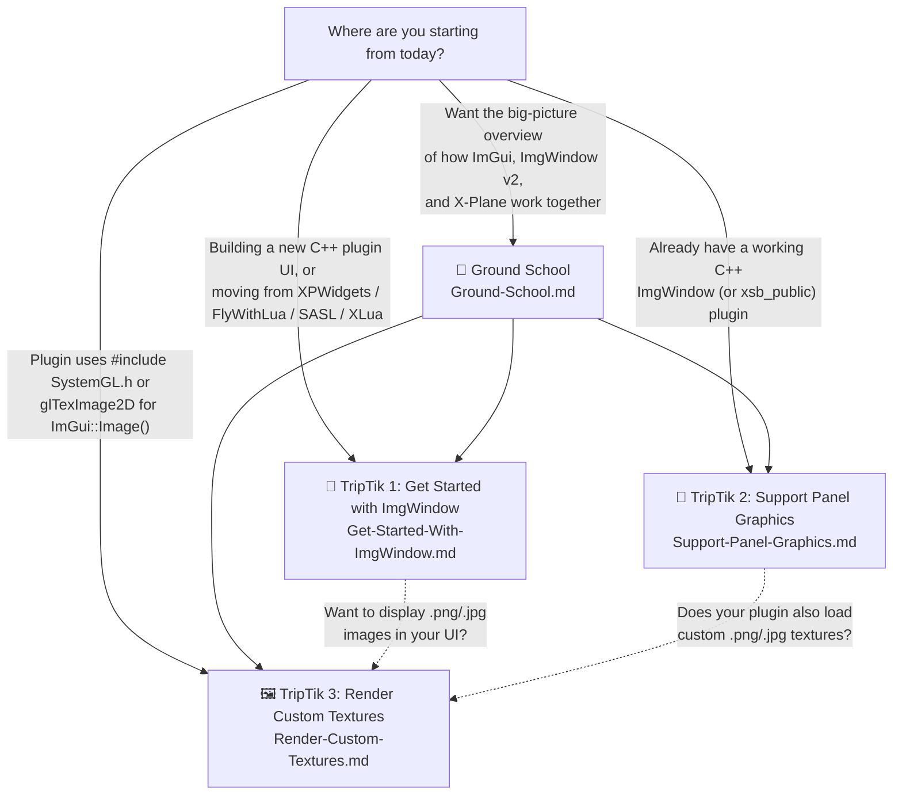

# ImgWindow v2 How-To Guides ("TripTiks")

Welcome to the **ImgWindow v2** practical How-To series!

Unlike dense API reference documentation, these guides are structured like visual, turn-by-turn **"AAA TripTiks"**—walking you step-by-step from wherever your X-Plane plugin is today to a modern, future-proofed **Dear ImGui** user interface with zero guesswork.

---

## 🗺️ Route Map: Which Guide Should I Read First?

---

## 📚 Available Guides

| Guide | Who It's For | What You'll Accomplish |
| :--- | :--- | :--- |
| 🧭 [**Ground-School.md**](Ground-School.md) *(Optional Foundation)* | **Anyone curious about the big picture**—whether you are brand new to `ImgWindow` or have used v1 for years without thinking about how it renders under the hood. | Understand how Dear ImGui's immediate-mode `ImDrawList` "firehose" works during X-Plane's 2D UI phase, why `ImgWindow v2` can support both **Panel Graphics** and **OpenGL** in a single binary without magic, and how `ImgWindow v2` unifies years of community improvements. |
| 🛫 [**Get-Started-With-ImgWindow.md**](Get-Started-With-ImgWindow.md) *(TripTik 1 — Starter Guide)* | **Newcomers to `ImgWindow`**—including developers starting a new C++ plugin, graduating a prototype from **`FlyWithLua`**, **`SASL`**, or **`XLua`**, or escaping X-Plane's legacy declarative **`XPWidgets`** API. *(Zero OpenGL or Panel Graphics knowledge needed!)* | Use [`sparker256/imgui4xp`](https://github.com/sparker256/imgui4xp) as a turnkey starter project, drop in `ImgWindow v2` for automatic Panel Graphics + backward compatibility back to X-Plane 11, and supercharge your UI with [`contrib/includes.h`](../../contrib/includes.h) widgets. |
| 🚀 [**Support-Panel-Graphics.md**](Support-Panel-Graphics.md) *(TripTik 2 — v1 $\rightarrow$ v2 Upgrade)* | **Existing `ImgWindow` (or `xsb_public`) plugin authors** whose plugins don't manage custom OpenGL textures directly—you just subclassed `ImgWindow` and want the v2 upgrade. | Upgrade your existing `ImgWindow` setup to **ImgWindow v2** in ~10 minutes so your plugin automatically renders via X-Plane 12.4.4+'s native **Panel Graphics** pipeline while running identically on older X-Plane 12 and X-Plane 11 builds. |
| 🖼️ [**Render-Custom-Textures.md**](Render-Custom-Textures.md) *(TripTik 3 — Custom Images)* | **Developers whose plugins draw `.png` / `.jpg` images** via `ImGui::Image()` and currently use `#include "SystemGL.h"`, `XPLMGenerateTextureNumbers()`, and `glTexImage2D()`. | **Delete 100% of custom OpenGL code from your plugin** by replacing raw `gl*` texture management with `ImgWindow::CreateTexture()` and `ImgWindow::DeleteTexture()`—getting both Panel Graphics and OpenGL support for free. Includes a real-world case study from `imgui4xp`. |

---

## Contributing a How-To Guide

Have a pattern, workflow, or integration technique that other X-Plane plugin developers would benefit from? Contributions are welcome!

### Guidelines for New TripTiks:
1. **Visual & Turn-by-Turn:** Start with a route strip-map diagram so readers can see every stop from start to finish at a glance.
2. **Welcoming Entry Points:** Clearly state *who the guide is for* and *what nice-to-have background helps* (without turning newcomers away), and link to [**Ground-School.md**](Ground-School.md) for architectural background.
3. **Actionable "Lane Guidance" Diffs:** Show clear before/after code diffs (`-` / `+`) and call out SDK quirks using GitHub-style alerts (`> [!WARNING]`, `> [!TIP]`).
4. **Link from this Index:** When submitting a PR with a new guide, add an entry to the route map and table above.
