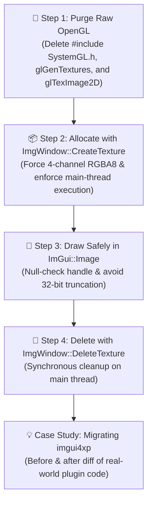

# TripTik 3: Render Custom Textures (`ImGui::Image`)

> [!TIP]
> **TripTik Navigation:**
> * 🧭 **[Ground-School.md](Ground-School.md)** *(Architecture Overview — read this first if you want the big picture)*
> * 🛫 **[TripTik 1: Get Started with ImgWindow](Get-Started-With-ImgWindow.md)** *(Starter guide for new C++ plugins or migrating from Lua/XPWidgets)*
> * 🚀 **[TripTik 2: Support Panel Graphics](Support-Panel-Graphics.md)** *(Upgrading an existing `ImgWindow` plugin to v2)*
> * 🖼️ **TripTik 3: Render Custom Textures** *(You are here — rendering `.png`/`.jpg` images via `CreateTexture()`)*

---

## 🗺️ Route Strip Map



---

## 🎯 Who This Guide Is For

This TripTik is for developers who have used earlier versions of `ImgWindow` (or standalone Dear ImGui in X-Plane) and already render custom imagery inside their windows using `ImGui::Image()` or `ImGui::ImageButton()`. Historically, that meant binding textures through the legacy **OpenGL** pipeline and storing 32-bit integer handles (`GLuint`, `int`, or truncated `(ImTextureID)(intptr_t)glId`).

If your plugin loads **external 2D images**—e.g., JPG, PNG, or other file formats containing images such as plugin logos, interactive checklists, aircraft diagrams, moving map tiles, or weather radar—this guide will walk you through transitioning those textures to `ImgWindow v2`.

> [!NOTE]
> **What Textures Are We Talking About?**
> * ✅ **Custom 2D plugin imagery:** JPG, PNG, BMP, or raw memory buffers drawn inside your ImGui windows.
> * ❌ **Font Atlas textures:** Automatically managed for you by `ImgFontAtlas` (see [TripTik 1](Get-Started-With-ImgWindow.md)).
> * ❌ **X-Plane World/Scenery textures:** Liveries, scenery orthophotos, and 3D `.obj` textures are handled directly by X-Plane's native scenery engine.

### Why Migrate? De-OpenGL-ifying Your Textures

Our core promise with `ImgWindow v2` is that you can completely **"de-OpenGL-ify"** your texture handling. By replacing raw `glGenTextures()`/`glTexImage2D()` and `glDeleteTextures()` calls with `ImgWindow::CreateTexture()` and `ImgWindow::DeleteTexture()`, respectively, your plugin cleanly **unlocks X-Plane 12.4.4+'s Panel Graphics rendering pipeline**.

Under the hood, `ImgWindow` dynamically routes texture allocation to Vulkan/Metal on modern simulators while transparently maintaining legacy OpenGL textures when running on older X-Plane releases. As long as you follow the clear guidelines spelled out in this guide, your plugin gains zero-friction modern graphics compatibility.

However, because modern graphics drivers (Vulkan and Metal) are significantly stricter and less forgiving than legacy OpenGL, transitioning requires avoiding four critical architectural pitfalls.

---

## ⚠️ The Four Pitfalls of Panel Graphics Textures

In legacy X-Plane 11 and older X-Plane 12 plugins, drawing custom images meant calling raw OpenGL functions: `glGenTextures()`, `XPLMBindTexture2d()`, and `glTexImage2D()`. 

Under modern **Panel Graphics** (X-Plane 12.4.4+), raw OpenGL handles cannot be used. Attempting to feed an OpenGL texture into the modern pipeline will cause an immediate crash. 

Here are the four traps and how `ImgWindow v2` solves them:

| Trap | What Happens If You Do It | The ImgWindow v2 Solution |
| :--- | :--- | :--- |
| **1. The 64-bit Pointer Truncation Trap** | Assigning `CreateTexture()` to a 32-bit `GLuint` or `int` truncates the upper 32 bits of the Vulkan handle. X-Plane crashes with `Resource does not belong to your plugin`. | **Always declare texture variables as `ImTextureID`** (an `ImU64` / `void*` under the hood). |
| **2. The 3-Channel Buffer Overrun Trap** | Passing a 3-channel RGB image buffer to Panel Graphics causes a hardware buffer overrun crash in Vulkan/Metal. | **Always force 4 channels (`RGBA8`)** when decoding images (e.g. `stbi_load(..., 4)`). |
| **3. Background Thread Allocation Trap** | Calling texture creation from a background worker thread (`std::thread`, `std::async`) asserts and crashes X-Plane. | **Decode file bytes on your background thread**, but call `ImgWindow::CreateTexture()` on the **main thread**. |
| **4. The Uninitialized Handle Trap** | Passing garbage memory from an uninitialized variable to `ImGui::Image()` causes Vulkan to dereference invalid pointers. | **Always null-initialize texture handles** to `(ImTextureID)0`. |

---

## 🚫 Step 1: Purge Raw OpenGL Texture Code

First, remove all dependencies on OpenGL headers and raw `gl*` texture calls from your plugin.

### Remove OpenGL Headers
In your source files, delete:
```cpp
// ❌ REMOVE THESE HEADERS:
#include "SystemGL.h"
#include <GL/gl.h>
```

`ImgWindow v2` completely abstracts the underlying graphics drivers. Your plugin code only needs `#include "ImgWindow.h"`!

---

## 📦 Step 2: Allocate Textures with `ImgWindow::CreateTexture()`

Instead of manually generating OpenGL texture IDs, use the unified `ImgWindow::CreateTexture()` API. It automatically inspects the runtime environment:
* On **X-Plane 12.4.4+**, it allocates via the native Vulkan/Metal Panel Graphics pipeline (`XPLMCreateTexture`).
* On **X-Plane 11 and earlier X-Plane 12**, it allocates via standard OpenGL.

Both paths return a unified, driver-agnostic **`ImTextureID`**.

```cpp
#include "ImgWindow.h"
#include "stb_image.h"

// 1. Always declare as ImTextureID and null-initialize!
static ImTextureID g_PluginLogoTexture = (ImTextureID)0;
static ImVec2      g_PluginLogoSize    = ImVec2(0.0f, 0.0f);

void LoadPluginLogo(const std::string& filePath) {
    int width = 0, height = 0, channels = 0;

    // 2. CRITICAL: Force 4 channels (RGBA) to prevent Vulkan buffer overruns!
    unsigned char* pixelData = stbi_load(filePath.c_str(), &width, &height, &channels, 4);
    if (!pixelData) {
        return; // File not found or corrupt image
    }

    // 3. MAIN THREAD ONLY: Create the unified texture
    g_PluginLogoTexture = ImgWindow::CreateTexture(pixelData, width, height);
    g_PluginLogoSize    = ImVec2(static_cast<float>(width), static_cast<float>(height));

    // 4. Free the CPU pixel buffer once uploaded to GPU VRAM
    stbi_image_free(pixelData);
}
```

> [!CAUTION]
> **Strict Main-Thread Execution:**
> `ImgWindow::CreateTexture()` calls X-Plane SDK entry points. The XPLM API is strictly single-threaded. If you load large images asynchronously, run `stbi_load` on your background worker thread, but pass the resulting raw `pixelData` buffer to the main thread (e.g. during your next window draw or flight-loop callback) before calling `CreateTexture()`.

---

## 🎨 Step 3: Draw Safely with `ImGui::Image()`

Once loaded, drawing your texture in your window's `buildInterface()` method is standard Dear ImGui:

```cpp
void MyFlightWindow::buildInterface() {
    ImGui::TextUnformatted("Avionics Status Display");
    ImGui::Separator();

    // Guard against uninitialized or failed texture loads:
    if (g_PluginLogoTexture != (ImTextureID)0) {
        // Draw the image at its natural pixel dimensions:
        ImGui::Image(g_PluginLogoTexture, g_PluginLogoSize);

        // Or draw it scaled to fit a specific container width:
        float targetWidth = ImGui::GetContentRegionAvail().x;
        float aspectRatio = g_PluginLogoSize.y / g_PluginLogoSize.x;
        ImGui::Image(g_PluginLogoTexture, ImVec2(targetWidth, targetWidth * aspectRatio));
    } else {
        ImGui::TextDisabled("(Logo image not loaded)");
    }
}
```

> [!TIP]
> **Straight Alpha Blending Note:**
> Panel Graphics uses straight alpha blending. If your image asset has transparent pixels with black RGB values `(0, 0, 0, 0)`, it may cause dark halos around semi-transparent edges in Vulkan. When exporting assets from Photoshop or Figma, export with a clean matte or pre-multiply alpha.

---

## 🧹 Step 4: Clean Up with `ImgWindow::DeleteTexture()`

When your plugin unloads or replaces a texture, release it with `ImgWindow::DeleteTexture()`. 

Unlike early beta versions of X-Plane 12.4.4 that required complex flight loop callbacks to safely defer texture destruction, **`ImgWindow::DeleteTexture()` can be called synchronously on the main thread**:

```cpp
void UnloadPluginLogo() {
    if (g_PluginLogoTexture != (ImTextureID)0) {
        // Safe to call synchronously on the main thread:
        ImgWindow::DeleteTexture(g_PluginLogoTexture);

        // Always reset your handle to null!
        g_PluginLogoTexture = (ImTextureID)0;
        g_PluginLogoSize    = ImVec2(0.0f, 0.0f);
    }
}
```

---

## 💡 Case Study: Migrating `sparker256/imgui4xp`

Let's look at a real-world example. In Bill Good's canonical starter project [`sparker256/imgui4xp`](https://github.com/sparker256/imgui4xp), image loading in `imgui_starter_window.cpp` was originally written using raw OpenGL:

### 🔴 Before: Legacy OpenGL (`imgui4xp`)

```cpp
// In imgui_starter_window.h:
static int    image_id;   // ❌ 32-bit integer truncates Vulkan pointers!
static ImVec2 image_size;

// In imgui_starter_window.cpp:
#include "SystemGL.h"     // ❌ Ties your plugin to legacy OpenGL

int loadImage(const std::string& fileName, int& imgWidth, int& imgHeight) {
    int nComps;
    uint8_t *data = stbi_load(fileName.c_str(), &imgWidth, &imgHeight, &nComps, sizeof(uint32_t));
    if (!data) return 0;

    int id;
    XPLMGenerateTextureNumbers(&id, 1);
    XPLMBindTexture2d(id, 0);
    glTexParameteri(GL_TEXTURE_2D, GL_TEXTURE_MIN_FILTER, GL_LINEAR);
    glTexParameteri(GL_TEXTURE_2D, GL_TEXTURE_MAG_FILTER, GL_LINEAR);
    glPixelStorei(GL_UNPACK_ROW_LENGTH, 0);
    glTexImage2D(GL_TEXTURE_2D, 0, GL_RGBA, imgWidth, imgHeight, 0, GL_RGBA, GL_UNSIGNED_BYTE, data);

    stbi_image_free(data);
    return id; // ❌ Breaks completely on X-Plane 12.4.4+ Panel Graphics!
}
```

### 🟢 After: Modern `ImgWindow v2` (Universal Dynamic Bridge)

```cpp
// In imgui_starter_window.h:
static ImTextureID image_id = (ImTextureID)0; // ✅ 64-bit safe, driver-agnostic
static ImVec2      image_size;

// In imgui_starter_window.cpp:
// #include "SystemGL.h" -- DELETED! No OpenGL headers required!

ImTextureID loadImage(const std::string& fileName, int& imgWidth, int& imgHeight) {
    int nComps;
    // Force 4 channels (RGBA)
    uint8_t *data = stbi_load(fileName.c_str(), &imgWidth, &imgHeight, &nComps, 4);
    if (!data) return (ImTextureID)0;

    // One line handles OpenGL on XP11 AND Vulkan/Metal on XP12.4.4+:
    ImTextureID id = ImgWindow::CreateTexture(data, imgWidth, imgHeight);

    stbi_image_free(data);
    return id;
}

// Cleanup:
void deleteImage() {
    if (image_id != (ImTextureID)0) {
        ImgWindow::DeleteTexture(image_id);
        image_id = (ImTextureID)0;
    }
}
```

### 🎯 What Changed?
1. **Deleted 10 lines of low-level OpenGL boilerplate** (`XPLMGenerateTextureNumbers`, `XPLMBindTexture2d`, `glTexParameteri`, `glTexImage2D`).
2. **Removed `#include "SystemGL.h"`** entirely.
3. **Refactored `int` to `ImTextureID`**, eliminating the 64-bit pointer truncation crash.
4. **Instant compatibility**: The exact same binary now runs on X-Plane 11 (OpenGL) and X-Plane 12.4.4+ (Panel Graphics) with zero runtime branching or `#ifdef` logic in your UI code!

---

## 🧭 What's Next?

* 🚀 **Migrating an existing plugin framework?**
  Review **[TripTik 2: Support Panel Graphics (`Support-Panel-Graphics.md`)](Support-Panel-Graphics.md)** for build configuration and shutdown rules.
* 🎨 **Ready to enhance your UI controls?**
  Check out the **[`contrib/` UX Suite](../../contrib/README.md)** for toggle buttons, mouse-wheel dials, 1-click resets with undo, and rich Markdown tooltips.
