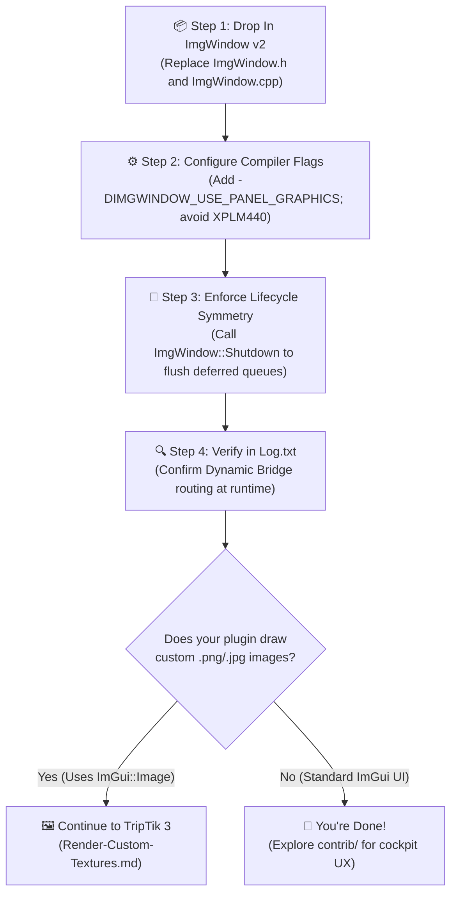

# TripTik 2: Support Panel Graphics (Migrating from Legacy OpenGL)

> [!TIP]
> **TripTik Navigation:**
> * 🧭 **[Ground-School.md](Ground-School.md)** *(Architecture Overview — read this first if you want the big picture)*
> * 🛫 **[TripTik 1: Get Started with ImgWindow](Get-Started-With-ImgWindow.md)** *(Starter guide for new C++ plugins or migrating from Lua/XPWidgets)*
> * 🚀 **TripTik 2: Support Panel Graphics** *(You are here — upgrading an existing `ImgWindow` plugin to v2)*
> * 🖼️ **[TripTik 3: Render Custom Textures](Render-Custom-Textures.md)** *(Rendering `.png`/`.jpg` images via `CreateTexture()`)*

---

## 🗺️ Route Strip Map



---

## 🎯 Who This Guide Is For

This TripTik is for developers who **already have a working X-Plane plugin** using an earlier version of `ImgWindow` (such as `v1.x`, `v1.3.0`, or the original `xsb_public` fork) and want to:

* **Support X-Plane 12.4.4+ modern Panel Graphics**: Take full advantage of Laminar Research's native Vulkan/Metal panel rendering pipeline without frame stutters or graphics context stalls.
* **Maintain 100% Backward Compatibility**: Keep supporting your existing users running older X-Plane 12 builds and X-Plane 11 with a **single compiled binary**—no separate downloads or branching codebases.
* **Upgrade in under 10 minutes**: The core `ImgWindow` subclassing API (`buildInterface()`, `SetVisible()`, `SetWindowTitle()`, coordinate conversion) is 100% backward compatible.

> [!NOTE]
> If your plugin loads custom external images (such as aircraft diagrams, navigation charts, or icons) and draws them using `ImGui::Image()`, complete this guide first, then continue directly to **[TripTik 3: Render Custom Textures](Render-Custom-Textures.md)**.

---

## 📦 Step 1: Drop In `ImgWindow v2`

`ImgWindow v2` maintains strict backward compatibility with your existing window classes. You do not need to rewrite your UI layouts, widget loops, or window event logic.

1. Download or copy the latest `ImgWindow.h` and `ImgWindow.cpp` from the [`ImgWindow` repository](https://github.com/slgoldberg/ImgWindow) into your plugin's source tree, replacing your existing files.
2. If your plugin uses custom TrueType/OpenType fonts, also update `ImgFontAtlas.h` and `ImgFontAtlas.cpp`.

### Early Adopters Note (Upgrading from v1.3.0)
If your plugin was an early adopter of `v1.3.0` during the initial X-Plane 12.4.4 betas:
* **`SafeDeleteTexture()` is deprecated**: Replace any calls with `ImgWindow::DeleteTexture()`.
* **`SetTextureBakeDelay()` is deprecated**: X-Plane 12.4.4 now binds textures synchronously. You can safely remove this call (it is retained as an inline no-op for compilation).

---

## ⚙️ Step 2: Configure Compiler Flags in `CMakeLists.txt`

You control how `ImgWindow` interacts with Panel Graphics entirely through preprocessor definitions. 

`ImgWindow v2` offers three build configurations:

| Build Flag Configuration | Rendering Pipeline | Simulator Compatibility |
| :--- | :--- | :--- |
| **`-DIMGWINDOW_USE_PANEL_GRAPHICS`**<br>*(Do **NOT** define `XPLM440`)* | **Universal Dynamic Bridge (Recommended)**<br>Uses modern Panel Graphics if X-Plane 12.4.4+ is detected at runtime; gracefully falls back to legacy OpenGL on older simulators. | **Maximum Compatibility**<br>X-Plane 11.10+ through current X-Plane 12. |
| **`-DIMGWINDOW_USE_PANEL_GRAPHICS`**<br>**`-DXPLM440=1`** | **Strict Modern Mode**<br>Forces native Vulkan/Metal Panel Graphics and strips out legacy OpenGL fallbacks. | **Modern Only**<br>X-Plane 12.4.4 and newer only. |
| *(None / Default)* | **Strict Legacy OpenGL**<br>Renders purely via OpenGL 2D callbacks, ignoring Panel Graphics. | **Legacy**<br>X-Plane 11.10+ through current X-Plane 12. |

### The Recommended Setup: The Universal Dynamic Bridge

To enable the Dynamic Bridge in your `CMakeLists.txt`:

```cmake
# Enable the ImgWindow Dynamic Bridge:
add_definitions(-DIMGWINDOW_USE_PANEL_GRAPHICS)
```

> [!WARNING]
> 🔥 **The Boilerplate CMake Trap (`XPLM440`):**
> It is common practice in older plugin templates to append every SDK version sequentially:
> ```cmake
> # ❌ DO NOT DO THIS IF YOU WANT BACKWARD COMPATIBILITY:
> add_definitions(-DXPLM200=1 -DXPLM210=1 ... -DXPLM430=1 -DXPLM440=1)
> ```
> Laminar's SDK headers check `#if defined(XPLM440)`. Defining `XPLM440` at all (even as `XPLM440=0`!) inflates X-Plane's internal window creation structure (`XPLMCreateWindow_t`) to the v4.4 SDK dimensions. If this binary runs on X-Plane 11, passing this enlarged struct to older SDK versions can cause window creation failures or undefined behavior.
> 
> **The Fix:** If you want universal backward compatibility, stop your version definitions at `-DXPLM430=1` and let `-DIMGWINDOW_USE_PANEL_GRAPHICS` handle the runtime bridge!

---

## 🧹 Step 3: Enforce Lifecycle Symmetry & Shutdown (`ImgWindow::Shutdown()`)

Because modern Panel Graphics commands are queued into X-Plane's Vulkan/Metal rendering thread, destroying a texture handle (such as your font atlas) while ImGui is building its draw list would cause a graphics stall or crash.

To protect against this, `ImgWindow v2` implements a **1-frame deferred deletion queue**. When textures are released, they are safely reclaimed on the following frame.

However, during plugin disable or shutdown, **X-Plane stops running the flight loop entirely**. If your font atlas is destroyed at shutdown without flushing this queue, textures can be orphaned in VRAM.

### The Lifecycle Symmetry Rule:
* **Allocated in `XPluginStart`?** &rarr; Tear down in `XPluginStop`.
* **Allocated in `XPluginEnable`?** &rarr; Tear down in `XPluginDisable`.

Whenever you destroy your font atlas, call `ImgWindow::Shutdown()` immediately afterward to bypass the 1-frame delay and flush all queued GPU resources:

```cpp
#include "ImgWindow.h"

PLUGIN_API void XPluginStop(void) {
    // 1. Destroy any active ImgWindow instances
    g_MyWindow.reset();

    // 2. Destroy your font atlas (if using ImgFontAtlas)
    ImgWindow::sFontAtlas.reset();

    // 3. CRITICAL: Instantly flush the deferred deletion queue
    ImgWindow::Shutdown();
}
```

> [!IMPORTANT]
> Always call `ImgWindow::Shutdown()` **after** releasing your font atlas and window instances. Once `Shutdown()` is called, no further `ImgWindow` drawing should take place until the plugin is re-initialized.

---

## 🔍 Step 4: Launch & Verify in `Log.txt`

Build your plugin and launch X-Plane. When your first window is displayed, `ImgWindow` logs its dynamic routing decision to X-Plane's `Log.txt`.

### On X-Plane 12.4.4+ (Vulkan / Metal):
```text
ImgWindow: Rendering via XPLM v4.4 Panel Graphics
```

### On X-Plane 11 or Earlier X-Plane 12 (OpenGL):
```text
ImgWindow: Rendering via Legacy OpenGL
```

If you see this log entry, your plugin is officially running on the modern Panel Graphics pipeline!

---

## 🧭 Where to Go Next

* 🖼️ **Does your plugin draw `.png` / `.jpg` images with `ImGui::Image()`?**
  Continue to **[TripTik 3: Render Custom Textures (`Render-Custom-Textures.md`)](Render-Custom-Textures.md)** to eliminate raw `glTexImage2D` calls and migrate to `ImgWindow::CreateTexture()`.
* 🎨 **Want to elevate your UI beyond default game-dev debug menus?**
  Explore the **[`contrib/` UX Suite](../../contrib/README.md)** for animated physical switches, mouse-wheel stepped dials and sliders, 1-click resets with undo, stationary tooltips, and Markdown rendering.
